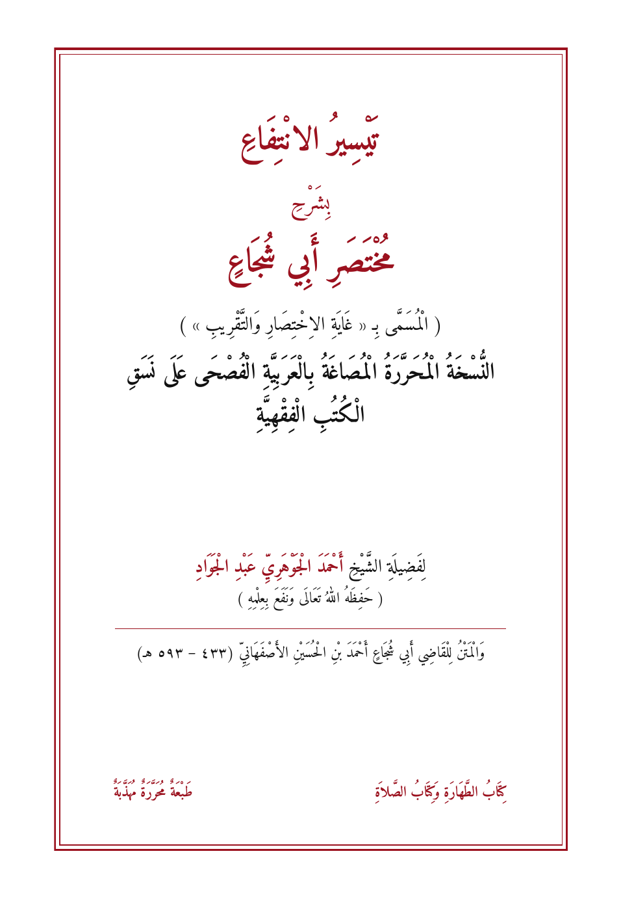
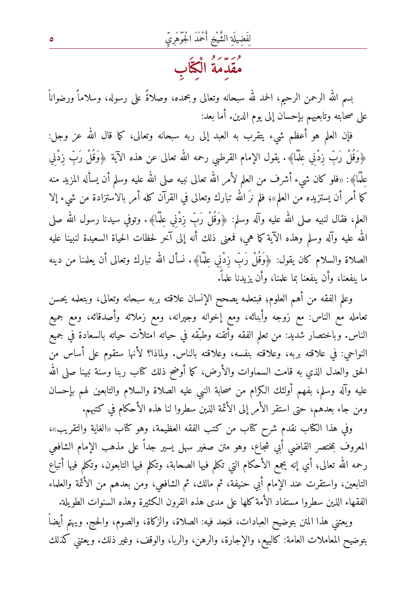
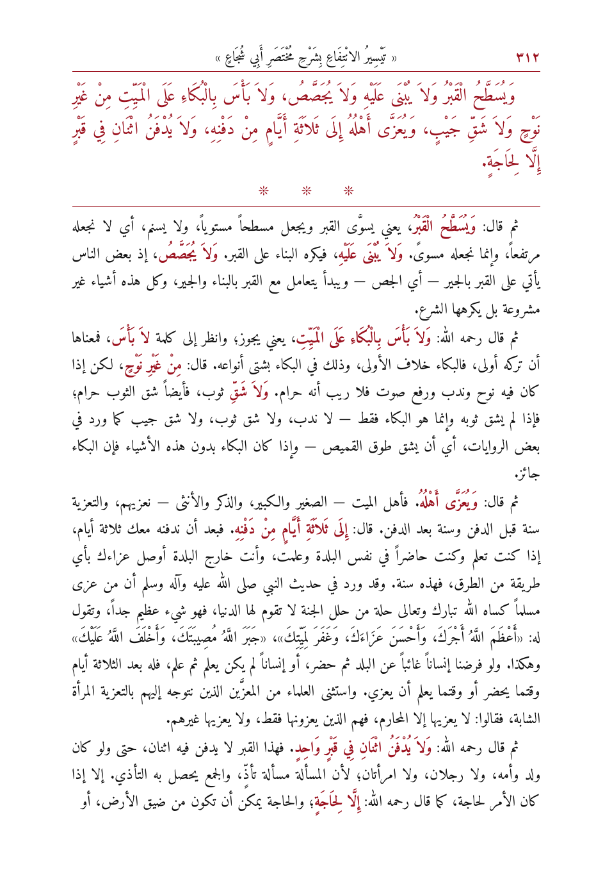
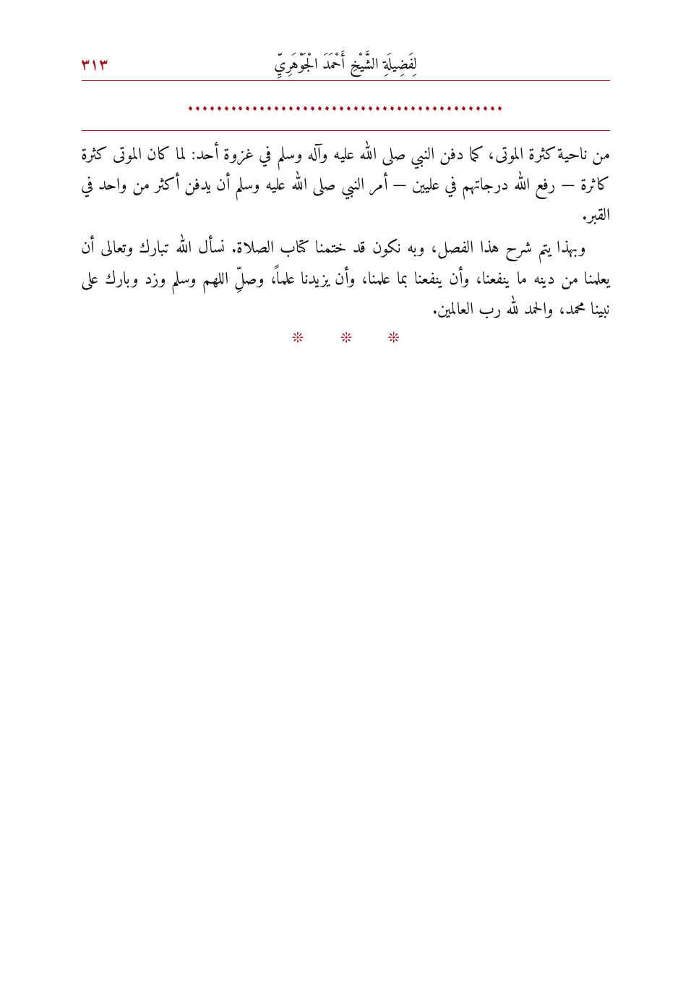
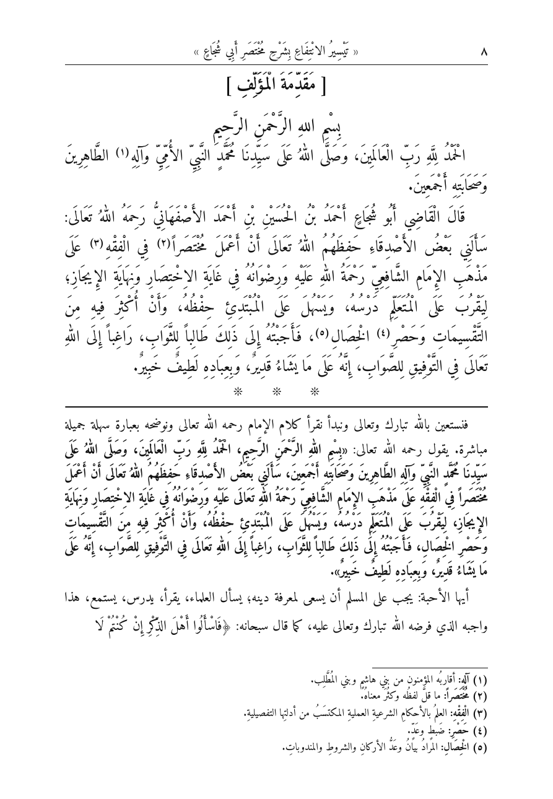
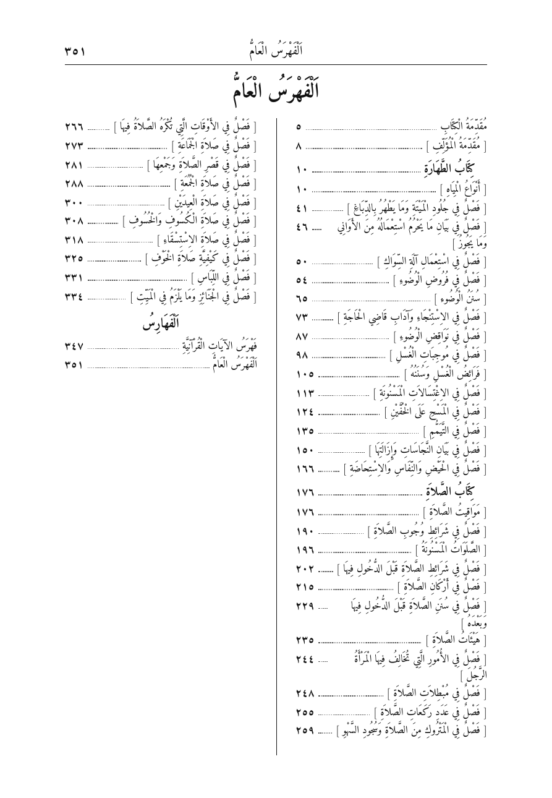

# تَيْسِيرُ الانْتِفَاعِ بِشَرْحِ مُخْتَصَرِ أَبِي شُجَاعٍ — لِفَضِيلَةِ الشَّيْخِ أَحْمَدَ الْجَوْهَرِيِّ
### الإِصْدَارُ الْمُزْدَوَجُ (`v3.2.0`): النُّسْخَةُ الْمُحَرَّرَةُ عَلَى نَسَقِ الْكُتُبِ الْفِقْهِيَّةِ (`٣١٨ ص` — `٨٠,٢٩٥ ك`) + النُّسْخَةُ الْحَرْفِيَّةُ الْكَامِلَةُ (`٣٥١ ص` — `٩٦,٣٩٩ ك`)

[](#٥-جدول-اللقاءات-الصوتية-الخمسة-والعشرين-وروابطها-الكاملة)
[](./تيسير_الانتفاع_بشرح_مختصر_أبي_شجاع_النسخة_المحررة/تيسير_الانتفاع_بشرح_مختصر_أبي_شجاع_النسخة_المحررة.pdf)
[](./تيسير_الانتفاع_بشرح_مختصر_أبي_شجاع.pdf)
[](./book_engine/glossary_data.json)

---

## ١. نبذة تعريفية بالمشروع والإصدارات المعتمدة (`v3.2.0`)

يضم هذا المستودع **طبعتين كاملتين متكاملتين** لكتاب **«تَيْسِيرُ الانْتِفَاعِ بِشَرْحِ مُخْتَصَرِ أَبِي شُجَاعٍ»** (مَتْنُ الْغَايَةِ وَالتَّقْرِيبِ فِي الْفِقْهِ الشَّافِعِيِّ) لفضيلة الشيخ **أحمد الجوهري عبد الجواد** (حفظه الله تعالى):

1. **النُّسْخَةُ الْمُحَرَّرَةُ الْمُصَاغَةُ بِالْعَرَبِيَّةِ الْفُصْحَى عَلَى نَسَقِ الْكُتُبِ الْفِقْهِيَّةِ (الجديد في `v3.2.0` — `318` صفحة — `80,295` كلمة في `165` مقطعاً فقهياً)**:
   - تنقية الشرح بالكامل من الألفاظ العامية، والتكرار والانقطاع الشفوي، وفواتح الدروس وخواتيمها، ومقاطع الأسئلة الحية للمستمعين (`L01_U08` و`L01_U09`)، وإعادة صياغتها **بالعربية الفصحى الميسرة** في أسلوب كتاب علمي مقروء، مع **الأمانة التامة في حفظ جميع الأحكام والأمثلة والشروط والتقاسيم والآيات (`100%` متطابقة) دون تغيير في المعنى أو زيادة من الخارج**.
   - تفتتح **مقدمة الكتاب** (`ص ٥`) ببسملة وحمدلة متصلة: *«بسم الله الرحمن الرحيم، الحمد لله سبحانه وتعالى وبحمده...»*، ويختتم الكتاب بدعاء ختامي ملائم (`ص ٣١٣`)، ثم **فهرس الآيات القرآنية والفهرس العام** (`ص ٣١٤ – ٣١٨`).
2. **النُّسْخَةُ الْحَرْفِيَّةُ الْكَامِلَةُ كَمَا أُلْقِيَتْ (`v3.1.0` — `351` صفحة — `96,399` كلمة في `167` مقطعاً فقهياً)**:
   - محفوظة كاملةً دون حذف أو اختصار لمن يرغب في مراجعة التفريغ الصوتي الحرفي الكامل للقاءات الـ ٢٥ (`مقدمة الكتاب` مفتتحةً بـ *«السلام عليكم»* ص ٥–٧، ثم `مقدمة المؤلف` ص ٨–٩، ف`كتاب الطهارة` ص ١٠–١٧٥، و`كتاب الصلاة` ص ١٧٦–٣٤٦، فالفهارس ص ٣٤٧–٣٥١).

### الخصائص الطباعية المشتركة في الطبعتين (`PDF` + `DOCX` + `HTML` + `Markdown`):
- **لوحة الغلاف الأمامية المذهّبة (`ص ١`)** بمقاس `162×234 مم`، متبوعةً بلوحة العنوان وبيانات النسخة ولوحة البسملة (`ص ١ – ٤`).
- **فصل المقاطع ومنع التداخل في الصفحات**: بدء كل وحدة متنية جديدة مستقلة مع خالص شرحها (`............................................` عند الامتداد)، واستقلال **`وَيُسَطَّحُ الْقَبْرُ`** أعلى الصفحة الجديدة (`ص ٣١٢` في المحررة، `ص ٣٤٥` في الحرفية).
- **حواشي غريب المتن لكل صفحة من رسالة «الأَنوَارُ عَلَى غَايَةِ الاِخْتِصَارِ»**: إضافة `31` حاشية للمفردات غير المشروحة في الدرس، منسوبةً لجامعها **عبد الرحمن محمد نور الدين** (`ص ٣`)، بترقيم مستقل يبدأ من `(١)` في كل صفحة دون تكرار.
- **نسخة لونين (أحمر قاني `#9b111e` وأسود `#111111` على أبيض `#ffffff`)** إلى جانب **النسخة الكلاسيكية** بنفس عدد الصفحات (`318 == 318` للمحررة، و`351 == 351` للحرفية).
- **ملفات Word (`.docx`) قابلة للتعديل** بمقاس `162×234 مم` وتقسيم الصفحات المطابق والهوامش والترويسات التراثية والحواشي.

---

## ٢. جميع الروابط المباشرة والملفات الرئيسية

### أ. النسخة المحررة على نسق الكتب الفقهية (`v3.2.0` — ٣١٨ صفحة)

| المسار في المستودع | المحتوى والوظيفة |
| :--- | :--- |
| [`تيسير_الانتفاع_بشرح_مختصر_أبي_شجاع_النسخة_المحررة.pdf`](./تيسير_الانتفاع_بشرح_مختصر_أبي_شجاع_النسخة_المحررة.pdf) | **النسخة المحررة الكلاسيكية (`PDF` — ٣١٨ صفحة — ١٦٢×٢٣٤ مم)** |
| [`تيسير_الانتفاع_بشرح_مختصر_أبي_شجاع_النسخة_المحررة_نسخة_لونين.pdf`](./تيسير_الانتفاع_بشرح_مختصر_أبي_شجاع_النسخة_المحررة/تيسير_الانتفاع_بشرح_مختصر_أبي_شجاع_النسخة_المحررة_نسخة_لونين.pdf) | **النسخة المحررة — نسخة اللونين (`PDF` — ٣١٨ صفحة — أحمر وأسود على أبيض)** |
| [`تيسير_الانتفاع_بشرح_مختصر_أبي_شجاع_النسخة_المحررة.docx`](./تيسير_الانتفاع_بشرح_مختصر_أبي_شجاع_النسخة_المحررة/تيسير_الانتفاع_بشرح_مختصر_أبي_شجاع_النسخة_المحررة.docx) | **ملف Word القابل للتعديل — المحررة الكلاسيكية (`.docx` — ٣١٨ صفحة منطقية)** |
| [`تيسير_الانتفاع_بشرح_مختصر_أبي_شجاع_النسخة_المحررة_نسخة_لونين.docx`](./تيسير_الانتفاع_بشرح_مختصر_أبي_شجاع_النسخة_المحررة/تيسير_الانتفاع_بشرح_مختصر_أبي_شجاع_النسخة_المحررة_نسخة_لونين.docx) | **ملف Word القابل للتعديل — المحررة نسخة لونين (`.docx` — ٣١٨ صفحة منطقية)** |
| [`viewer/matn_abi_shuja_edited.html`](./viewer/matn_abi_shuja_edited.html) | **القارئ التفاعلي للنسخة المحررة (`HTML` — ٣١٨ ص — ٣ أنماط لون)** |
| [`تيسير_الانتفاع_بشرح_مختصر_أبي_شجاع_النسخة_المحررة/`](./تيسير_الانتفاع_بشرح_مختصر_أبي_شجاع_النسخة_المحررة/) | **المجلد الجامع للنسخة المحررة**: الملفات الأربعة + `Markdown` (المجلد الكامل + المجلدين + ٢٥ فصلاً/درساً) |
| [`edited_lessons/`](./edited_lessons/) | **ملفات الوحدات المحررة بالفصحى (`L01.txt` .. `L25.txt`)**: `165` مقطعاً (`80,295` كلمة، مفحوصة عبر `scripts/verify_edited.py`) |

---

### ب. الروابط السحابية (YouTube & Google Docs)

| المورد | الرابط المباشر | الوصف |
| :--- | :--- | :--- |
| **قائمة تشغيل اليوتيوب الأصلية (٢٥ درساً)** | [سلسلة شرح متن أبي شجاع — الشيخ أحمد الجوهري](https://youtube.com/playlist?list=PLjR2AWKLjP8QXzoJM0ptza1ENS850YqBX) | السلسلة الصوتية/المرئية الكاملة التي تم تفريغها ومراجعتها |
| **المجلد الكامل على Google Docs (الحرفي ١–٢٥)** | [فتح المستند الكامل على Google Docs](https://docs.google.com/document/d/1JWeLsDtlU76TSQt-uac_vmXxDf1RCLLogj3tjZsYxUE/edit) | المجلد الكامل للتفريغ الحرفي وحواشي *الأنوار* وتنسيق `Amiri` واتجاه `RTL` |
| **المجلد الأول على Google Docs (كتاب الطهارة: ١–١٢)** | [فتح المجلد الأول: كتاب الطهارة](https://docs.google.com/document/d/1xqRrQTK862s9p8OchjSHOBRyFbGeWxndfiY2vj3hsN8/edit) | اللقاءات ١ إلى ١٢ (مقدمة الكتاب، ومقدمة المؤلف، وكتاب الطهارة كاملاً) |
| **المجلد الثاني على Google Docs (كتاب الصلاة: ١٣–٢٥)** | [فتح المجلد الثاني: كتاب الصلاة](https://docs.google.com/document/d/167eTHwNCyjte0hrtJZQ9oCKvjBIGtjv9fkM2bFPRJ3M/edit) | اللقاءات ١٣ إلى ٢٥ (كتاب الصلاة وفصل الجنائز كاملاً) |

---

### ج. ملفات النسخة الحرفية الكاملة ومحرك الكتاب (`v3.1.0` — ٣٥١ صفحة)

| المسار في المستودع | المحتوى والوظيفة |
| :--- | :--- |
| [`تيسير_الانتفاع_بشرح_مختصر_أبي_شجاع.pdf`](./تيسير_الانتفاع_بشرح_مختصر_أبي_شجاع.pdf) | **النسخة الحرفية الكلاسيكية الكاملة (`PDF` — ٣٥١ صفحة — ١٦٢×٢٣٤ مم)** مع الغلاف والحواشي |
| [`تيسير_الانتفاع_بشرح_مختصر_أبي_شجاع/تيسير_الانتفاع_بشرح_مختصر_أبي_شجاع_نسخة_لونين.pdf`](./تيسير_الانتفاع_بشرح_مختصر_أبي_شجاع/تيسير_الانتفاع_بشرح_مختصر_أبي_شجاع_نسخة_لونين.pdf) | **النسخة الحرفية — لونين (`PDF` — ٣٥١ صفحة — أحمر وأسود على أبيض)** بنفس الترقيم والتقسيم |
| [`تيسير_الانتفاع_بشرح_مختصر_أبي_شجاع/تيسير_الانتفاع_بشرح_مختصر_أبي_شجاع.docx`](./تيسير_الانتفاع_بشرح_مختصر_أبي_شجاع/تيسير_الانتفاع_بشرح_مختصر_أبي_شجاع.docx) | **ملف Word القابل للتعديل — الحرفي الكلاسيكي (`.docx`)** بمقاس `162×234 مم` |
| [`تيسير_الانتفاع_بشرح_مختصر_أبي_شجاع/تيسير_الانتفاع_بشرح_مختصر_أبي_شجاع_نسخة_لونين.docx`](./تيسير_الانتفاع_بشرح_مختصر_أبي_شجاع/تيسير_الانتفاع_بشرح_مختصر_أبي_شجاع_نسخة_لونين.docx) | **ملف Word القابل للتعديل — الحرفي نسخة لونين (`.docx`)** بمقاس `162×234 مم` |
| [`index.html`](./index.html) / [`viewer/matn_abi_shuja_transcripts.html`](./viewer/matn_abi_shuja_transcripts.html) | **القارئ التفاعلي للنسخة الحرفية الـ ٣٥١ صفحة** (يدعم **نسخة لونين / أبيض كلاسيكي / ورق قديم**) |
| [`تيسير_الانتفاع_بشرح_مختصر_أبي_شجاع/`](./تيسير_الانتفاع_بشرح_مختصر_أبي_شجاع/) | **المجلد الجامع للنسخة الحرفية**: الملفات الأربعة (`PDF` و`DOCX`) + ملفات `Markdown` |
| [`تفريغ_كامل_مجرد_كما_ذكر/`](./تفريغ_كامل_مجرد_كما_ذكر/) | **التفريغ الحرفي الخام المجرد (٢٥ ملف `.txt` + المجلد الجامع)** كما نطق به الشيخ قبل التقطيع المطبعي |
| [`clean_lessons/`](./clean_lessons/) | **ملفات الوحدات الحرفية (`L01.txt` .. `L25.txt`)**: `167` مقطعاً (`96,399` كلمة) |
| [`book_engine/`](./book_engine/) | **محرك الإخراج الطباعي وملفات Word**: `cover_front.png`، `curate_glossary.py`، `render_book.mjs`، `build_docx.py` |
| [`scripts/`](./scripts/) | أدوات التحقق والمزامنة: `verify_edited.py`، `verify_verbatim.py`، `build_viewer.py`، `update_gdocs_fath.py` |
| [`docs/SUMMARY.md`](./docs/SUMMARY.md) و[`docs/WORKFLOW_AND_STEPS.md`](./docs/WORKFLOW_AND_STEPS.md) | **ملخص الإصدار والدليل التفصيلي الكامل لجميع الخطوات التقنية والمنهجية** |

---

## ٣. نماذج مصورة من صفحات النسخة المحررة (`٣١٨ ص`) والنسخة الحرفية (`٣٥١ ص`)

### أ. نماذج من النسخة المحررة على نسق الكتب الفقهية (`v3.2.0` — ٣١٨ صفحة)

| صفحة العنوان — المحررة (ص ٢) | بيانات النسخة ومنهج التحرير (ص ٣) | مقدمة الكتاب مصاغة بالفصحى (ص ٥) |
| :---: | :---: | :---: |
|  |  |  |

| بدء «وَيُسَطَّحُ الْقَبْرُ» مستقلاً (ص ٣١٢) | خاتمة الكتاب الدعايئة (ص ٣١٣) | الفهرس العام باللونين (ص ٣١٨) |
| :---: | :---: | :---: |
|  |  |  |

### ب. نماذج من النسخة الحرفية الكاملة (`v3.1.0` — ٣٥١ صفحة)

| الغلاف الأمامي المذهّب (ص ١) | مقدمة الكتاب الحرفية بـ «السلام عليكم» (ص ٥) | مقدمة المؤلف وحواشي غريب المتن (ص ٨) |
| :---: | :---: | :---: |
|  |  |  |

| دعاء الاستسقاء باللونين والحواشي (ص ٣٢٣) | تتمة الموضع السابق مستقلّةً (ص ٣٤٤) | الفهرس العام بنظام العمودين (ص ٣٥١) |
| :---: | :---: | :---: |
|  |  |  |

---

## ٤. منهج العمل والخطوات التفصيلية الكاملة من البداية إلى النهاية

مرّ إنجاز هذا المشروع وإخراجه في صورته النهائية عبر **تسع مراحل متكاملة** موثقة بالتفصيل في [`docs/WORKFLOW_AND_STEPS.md`](./docs/WORKFLOW_AND_STEPS.md):

1. **سحب صوتيات السلسلة والتفريغ الحرفي الكامل** (٢٥ درساً، ما يزيد عن ٢٠ ساعة، إثبات كل كلام الشيخ كما هو).
2. **المراجعة السماعية المباشرة في المواضع ضعيفة الصوت** عبر استقطاع مقاطع `ffmpeg` وسماعها لإصلاح مواضع التشويش (اللقاءات ١، ٢، ٧، ٩، ١٠، ١٣).
3. **التحقق البرمجي من مطابقة الشرح الحرفي (`scripts/verify_verbatim.py`)**: اجتياز **`25/25 PASS`** لـ `96,399` كلمة شرح مع انعدام الحروف الأجنبية.
4. **بناء محرك الصفّ الطباعي (`162×234 مم`)** بالعناوين التراثية الأصيلة لمتن أبي شجاع، وعلامة المتابعة `............................................`، ومحاذاة `text-align-last: right`، وتوسيع المساحة السفلية.
5. **تحقيق الغلاف وفصل المقاطع المستقلة (`v3.0.0` / `v3.1.0`)**: وضع الغلاف المذهّب ص ١، ومنع دمج بقايا أي وحدة مع وحدة متنية تالية في صفحة واحدة.
6. **حواشي غريب المتن لكل صفحة من «الأَنوَارُ عَلَى غَايَةِ الاِخْتِصَارِ» (`curate_glossary.py`)**: إلحاق `31` معنى للمفردات غير المشروحة في الدرس، بترقيم يبدأ من `(١)` في كل صفحة دون تكرار.
7. **إنتاج نسخة اللونين + ملفات Word `.docx` القابلة للتعديل (`build_docx.py`)**: ملفات OOXML RTL صافية بمقاس `162×234 مم`.
8. **تحديث القارئ التفاعلي (`index.html`) ومستندات Google Docs الثلاثة**.
9. **التحرير الأدبي والفقهي للفصحى على نسق الكتب (`v3.2.0` — `edited_lessons/` و`verify_edited.py`)**: تحرير الدروس الـ ٢٥ وإزالة العامية والترحيب والختام والأسئلة (`80,295` كلمة في `165` وحدة)، مع حفظ ١٠٠٪ من الآيات والأحكام دون زيادة أو تغيير في المعنى، وتوليد نسختَي `PDF` و`DOCX` (`318` صفحة) والقارئ التفاعلي [`viewer/matn_abi_shuja_edited.html`](./viewer/matn_abi_shuja_edited.html).

---

## ٥. جدول الدروس واللقاءات الخمسة والعشرين وروابطها الكاملة

| م | موضوع الدرس / اللقاء التفصيلي | المدة | النسخة المحررة (`٣١٨ ص` — `٨٠,٢٩٥ ك`) | النسخة الحرفية (`٣٥١ ص` — `٩٦,٣٩٩ ك`) | النصوص المصدرية | يوتيوب |
| :-: | :--- | :-: | :---: | :---: | :---: | :---: |
| **١** | مقدمة الكتاب، ومقدمة المؤلف، وكتاب الطهارة (أنواع المياه) | ٧٣ د | [ص ٥–٢٠ (4,345 ك)](./تيسير_الانتفاع_بشرح_مختصر_أبي_شجاع_النسخة_المحررة/01_الدرس_الأول_مقدمة_الكتاب_وأنواع_المياه_وأقسامها.md) | [ص ٥–٢٥ (6,004 ك)](./تيسير_الانتفاع_بشرح_مختصر_أبي_شجاع/01_الدرس_الأول_مقدمة_الكتاب_وأنواع_المياه_وأقسامها.md) | [محرر](./edited_lessons/L01.txt) • [حرفي](./clean_lessons/L01.txt) | [🎥](https://www.youtube.com/watch?v=XNOZOX88_TE) |
| **٢** | تتمة أقسام المياه، وأحكام الماء النجس ومقدار القلتين | ٥٤ د | [ص ٢١–٣٥ (4,131 ك)](./تيسير_الانتفاع_بشرح_مختصر_أبي_شجاع_النسخة_المحررة/02_الدرس_الثاني_الماء_النجس_ومقدار_القلتين.md) | [ص ٢٦–٤٠ (4,439 ك)](./تيسير_الانتفاع_بشرح_مختصر_أبي_شجاع/02_الدرس_الثاني_الماء_النجس_ومقدار_القلتين.md) | [محرر](./edited_lessons/L02.txt) • [حرفي](./clean_lessons/L02.txt) | [🎥](https://www.youtube.com/watch?v=8PbuyNDIE8I) |
| **٣** | طهارة الجلود بالدباغ، وأحكام الأواني، وفصل السواك | ٥٣ د | [ص ٣٦–٤٨ (3,391 ك)](./تيسير_الانتفاع_بشرح_مختصر_أبي_شجاع_النسخة_المحررة/03_الدرس_الثالث_الدباغ_والأواني_والسواك.md) | [ص ٤١–٥٣ (3,682 ك)](./تيسير_الانتفاع_بشرح_مختصر_أبي_شجاع/03_الدرس_الثالث_الدباغ_والأواني_والسواك.md) | [محرر](./edited_lessons/L03.txt) • [حرفي](./clean_lessons/L03.txt) | [🎥](https://www.youtube.com/watch?v=F0Lj_OraMsM) |
| **٤** | فرائض الوضوء الستة وسننه العشرة | ٦١ د | [ص ٤٩–٦٤ (4,150 ك)](./تيسير_الانتفاع_بشرح_مختصر_أبي_شجاع_النسخة_المحررة/04_الدرس_الرابع_فرائض_الوضوء_وسننه.md) | [ص ٥٤–٧٠ (4,599 ك)](./تيسير_الانتفاع_بشرح_مختصر_أبي_شجاع/04_الدرس_الرابع_فرائض_الوضوء_وسننه.md) | [محرر](./edited_lessons/L04.txt) • [حرفي](./clean_lessons/L04.txt) | [🎥](https://www.youtube.com/watch?v=dSNEfyecEJM) |
| **٥** | تتمة سنن الوضوء، وأحكام الاستنجاء وآداب قاضي الحاجة | ٥٤ د | [ص ٦٥–٧٩ (3,739 ك)](./تيسير_الانتفاع_بشرح_مختصر_أبي_شجاع_النسخة_المحررة/05_الدرس_الخامس_تتمة_سنن_الوضوء_والاستطابة_وآداب_الخلاء.md) | [ص ٧١–٨٦ (4,195 ك)](./تيسير_الانتفاع_بشرح_مختصر_أبي_شجاع/05_الدرس_الخامس_تتمة_سنن_الوضوء_والاستطابة_وآداب_الخلاء.md) | [محرر](./edited_lessons/L05.txt) • [حرفي](./clean_lessons/L05.txt) | [🎥](https://www.youtube.com/watch?v=MS_ggWejJ_c) |
| **٦** | فصل نواقض الوضوء الستة | ٤٧ د | [ص ٨٠–٨٩ (2,877 ك)](./تيسير_الانتفاع_بشرح_مختصر_أبي_شجاع_النسخة_المحررة/06_الدرس_السادس_نواقض_الوضوء_الستة.md) | [ص ٨٧–٩٧ (3,699 ك)](./تيسير_الانتفاع_بشرح_مختصر_أبي_شجاع/06_الدرس_السادس_نواقض_الوضوء_الستة.md) | [محرر](./edited_lessons/L06.txt) • [حرفي](./clean_lessons/L06.txt) | [🎥](https://www.youtube.com/watch?v=2fDdOCKeDSo) |
| **٧** | موجبات الغسل الستة، وفرائض الغسل وسننه | ٥٩ د | [ص ٩٠–١٠٢ (3,367 ك)](./تيسير_الانتفاع_بشرح_مختصر_أبي_شجاع_النسخة_المحررة/07_الدرس_السابع_موجبات_الغسل_وفرائضه_وسننه.md) | [ص ٩٨–١١٢ (4,439 ك)](./تيسير_الانتفاع_بشرح_مختصر_أبي_شجاع/07_الدرس_السابع_موجبات_الغسل_وفرائضه_وسننه.md) | [محرر](./edited_lessons/L07.txt) • [حرفي](./clean_lessons/L07.txt) | [🎥](https://www.youtube.com/watch?v=IxmQMfJm4Hw) |
| **٨** | فصل الاغتسالات المسنونة السبعة عشر | ٤٢ د | [ص ١٠٣–١١١ (1,763 ك)](./تيسير_الانتفاع_بشرح_مختصر_أبي_شجاع_النسخة_المحررة/08_الدرس_الثامن_الأغسال_المسنونة_السبعة_عشر.md) | [ص ١١٣–١٢٣ (2,684 ك)](./تيسير_الانتفاع_بشرح_مختصر_أبي_شجاع/08_الدرس_الثامن_الأغسال_المسنونة_السبعة_عشر.md) | [محرر](./edited_lessons/L08.txt) • [حرفي](./clean_lessons/L08.txt) | [🎥](https://www.youtube.com/watch?v=2IVULUVrTio) |
| **٩** | فصل المسح على الخفين وشرائطه ومدته ومبطلاته | ٤٤ د | [ص ١١٢–١٢١ (2,928 ك)](./تيسير_الانتفاع_بشرح_مختصر_أبي_شجاع_النسخة_المحررة/09_الدرس_التاسع_أحكام_المسح_على_الخفين.md) | [ص ١٢٤–١٣٤ (3,191 ك)](./تيسير_الانتفاع_بشرح_مختصر_أبي_شجاع/09_الدرس_التاسع_أحكام_المسح_على_الخفين.md) | [محرر](./edited_lessons/L09.txt) • [حرفي](./clean_lessons/L09.txt) | [🎥](https://www.youtube.com/watch?v=b886hsfRkqA) |
| **١٠** | فصل التيمم وشرائطه وفرائضه وسننه ومبطلاته وحكم الجبائر | ٥٧ د | [ص ١٢٢–١٣٣ (3,572 ك)](./تيسير_الانتفاع_بشرح_مختصر_أبي_شجاع_النسخة_المحررة/10_الدرس_العاشر_أحكام_التيمم_وشروطه_وفرائضه.md) | [ص ١٣٥–١٤٧ (3,801 ك)](./تيسير_الانتفاع_بشرح_مختصر_أبي_شجاع/10_الدرس_العاشر_أحكام_التيمم_وشروطه_وفرائضه.md) | [محرر](./edited_lessons/L10.txt) • [حرفي](./clean_lessons/L10.txt) | [🎥](https://www.youtube.com/watch?v=fSZz4SWvWwE) |
| **١١** | تتمة أحكام صاحب الجبائر، وفصل النجاسات وإزالتها | ٦٢ د | [ص ١٣٤–١٤٦ (3,341 ك)](./تيسير_الانتفاع_بشرح_مختصر_أبي_شجاع_النسخة_المحررة/11_الدرس_الحادي_عشر_النجاسات_وكيفية_تطهيرها.md) | [ص ١٤٨–١٦٢ (4,772 ك)](./تيسير_الانتفاع_بشرح_مختصر_أبي_شجاع/11_الدرس_الحادي_عشر_النجاسات_وكيفية_تطهيرها.md) | [محرر](./edited_lessons/L11.txt) • [حرفي](./clean_lessons/L11.txt) | [🎥](https://www.youtube.com/watch?v=ZN9gepII_to) |
| **١٢** | تتمة النجاسات، وفصل الحيض والنفاس والاستحاضة ومحرماتها | ٥٤ د | [ص ١٤٧–١٥٧ (2,706 ك)](./تيسير_الانتفاع_بشرح_مختصر_أبي_شجاع_النسخة_المحررة/12_الدرس_الثاني_عشر_الحيض_والنفاس_والاستحاضة.md) | [ص ١٦٣–١٧٥ (3,624 ك)](./تيسير_الانتفاع_بشرح_مختصر_أبي_شجاع/12_الدرس_الثاني_عشر_الحيض_والنفاس_والاستحاضة.md) | [محرر](./edited_lessons/L12.txt) • [حرفي](./clean_lessons/L12.txt) | [🎥](https://www.youtube.com/watch?v=ogNG2R1gtvc) |
| **١٣** | كتاب الصلاة وتفصيل مواقيت الصلوات الخمس المفروضة | ٤٨ د | [ص ١٥٨–١٧٠ (3,477 ك)](./تيسير_الانتفاع_بشرح_مختصر_أبي_شجاع_النسخة_المحررة/13_الدرس_الثالث_عشر_كتاب_الصلاة_ومواقيتها.md) | [ص ١٧٦–١٨٩ (3,814 ك)](./تيسير_الانتفاع_بشرح_مختصر_أبي_شجاع/13_الدرس_الثالث_عشر_كتاب_الصلاة_ومواقيتها.md) | [محرر](./edited_lessons/L13.txt) • [حرفي](./clean_lessons/L13.txt) | [🎥](https://www.youtube.com/watch?v=iFyYlUyLIjE) |
| **١٤** | شرائط وجوب الصلاة، والصلوات المسنونة والسنن الرواتب | ٤٩ د | [ص ١٧١–١٨٢ (3,177 ك)](./تيسير_الانتفاع_بشرح_مختصر_أبي_شجاع_النسخة_المحررة/14_الدرس_الرابع_عشر_شرائط_وجوب_الصلاة_والسنن_الرواتب.md) | [ص ١٩٠–٢٠١ (3,769 ك)](./تيسير_الانتفاع_بشرح_مختصر_أبي_شجاع/14_الدرس_الرابع_عشر_شرائط_وجوب_الصلاة_والسنن_الرواتب.md) | [محرر](./edited_lessons/L14.txt) • [حرفي](./clean_lessons/L14.txt) | [🎥](https://www.youtube.com/watch?v=FmG1dhgHGdM) |
| **١٥** | فصل شرائط الصلاة قبل الدخول فيها | ٤٢ د | [ص ١٨٣–١٩٤ (3,113 ك)](./تيسير_الانتفاع_بشرح_مختصر_أبي_شجاع_النسخة_المحررة/15_الدرس_الخامس_عشر_شرائط_صحة_الصلاة_الخمسة.md) | [ص ٢٠٢–٢١٤ (3,691 ك)](./تيسير_الانتفاع_بشرح_مختصر_أبي_شجاع/15_الدرس_الخامس_عشر_شرائط_صحة_الصلاة_الخمسة.md) | [محرر](./edited_lessons/L15.txt) • [حرفي](./clean_lessons/L15.txt) | [🎥](https://www.youtube.com/watch?v=DsHfwqvZd-0) |
| **١٦** | فصل أركان الصلاة الثمانية عشر | ٥٦ د | [ص ١٩٥–٢٠٧ (3,412 ك)](./تيسير_الانتفاع_بشرح_مختصر_أبي_شجاع_النسخة_المحررة/16_الدرس_السادس_عشر_أركان_الصلاة_الثمانية_عشر.md) | [ص ٢١٥–٢٢٨ (3,993 ك)](./تيسير_الانتفاع_بشرح_مختصر_أبي_شجاع/16_الدرس_السادس_عشر_أركان_الصلاة_الثمانية_عشر.md) | [محرر](./edited_lessons/L16.txt) • [حرفي](./clean_lessons/L16.txt) | [🎥](https://www.youtube.com/watch?v=OXcmcyhZjXk) |
| **١٧** | فصل سنن الصلاة وأبعاضها وهيئاتها الخمس عشرة | ٥٥ د | [ص ٢٠٨–٢٢١ (3,172 ك)](./تيسير_الانتفاع_بشرح_مختصر_أبي_شجاع_النسخة_المحررة/17_الدرس_السابع_عشر_سنن_الصلاة_وأبعاضها_وهيئاتها.md) | [ص ٢٢٩–٢٤٣ (3,997 ك)](./تيسير_الانتفاع_بشرح_مختصر_أبي_شجاع/17_الدرس_السابع_عشر_سنن_الصلاة_وأبعاضها_وهيئاتها.md) | [محرر](./edited_lessons/L17.txt) • [حرفي](./clean_lessons/L17.txt) | [🎥](https://www.youtube.com/watch?v=eQ3AYmdm2U8) |
| **١٨** | ما تخالف فيه المرأة الرجل، ومبطلات الصلاة، وإحصاء ركعات الفرائض | ٤٢ د | [ص ٢٢٢–٢٣١ (2,547 ك)](./تيسير_الانتفاع_بشرح_مختصر_أبي_شجاع_النسخة_المحررة/18_الدرس_الثامن_عشر_مخالفة_المرأة_للرجل_ومبطلات_الصلاة_وإحصاء_الركعات.md) | [ص ٢٤٤–٢٥٥ (3,267 ك)](./تيسير_الانتفاع_بشرح_مختصر_أبي_شجاع/18_الدرس_الثامن_عشر_مخالفة_المرأة_للرجل_ومبطلات_الصلاة_وإحصاء_الركعات.md) | [محرر](./edited_lessons/L18.txt) • [حرفي](./clean_lessons/L18.txt) | [🎥](https://www.youtube.com/watch?v=ffya00W_gSE) |
| **١٩** | صلاة العاجز عن القيام، وفصل المتروك من الصلاة وسجود السهو | ٣٦ د | [ص ٢٣٢–٢٣٩ (2,158 ك)](./تيسير_الانتفاع_بشرح_مختصر_أبي_شجاع_النسخة_المحررة/19_الدرس_التاسع_عشر_صلاة_العاجز_وسجود_السهو.md) | [ص ٢٥٦–٢٦٥ (2,911 ك)](./تيسير_الانتفاع_بشرح_مختصر_أبي_شجاع/19_الدرس_التاسع_عشر_صلاة_العاجز_وسجود_السهو.md) | [محرر](./edited_lessons/L19.txt) • [حرفي](./clean_lessons/L19.txt) | [🎥](https://www.youtube.com/watch?v=G3JxD3peqIA) |
| **٢٠** | الأوقات التي تكره فيها الصلاة، وفصل صلاة الجماعة | ٣٩ د | [ص ٢٤٠–٢٤٩ (2,493 ك)](./تيسير_الانتفاع_بشرح_مختصر_أبي_شجاع_النسخة_المحررة/20_الدرس_العشرون_الأوقات_المكروهة_وصلاة_الجماعة.md) | [ص ٢٦٦–٢٧٦ (3,053 ك)](./تيسير_الانتفاع_بشرح_مختصر_أبي_شجاع/20_الدرس_العشرون_الأوقات_المكروهة_وصلاة_الجماعة.md) | [محرر](./edited_lessons/L20.txt) • [حرفي](./clean_lessons/L20.txt) | [🎥](https://www.youtube.com/watch?v=mfY_MLEYuyc) |
| **٢١** | تتمة صلاة الجماعة، وفصل قصر الصلاة وجمعها للمسافر والحاضر | ٣٨ د | [ص ٢٥٠–٢٥٩ (2,633 ك)](./تيسير_الانتفاع_بشرح_مختصر_أبي_شجاع_النسخة_المحررة/21_الدرس_الحادي_والعشرون_تتمة_الجماعة_وقصر_الصلاة_وجمعها.md) | [ص ٢٧٧–٢٨٧ (3,049 ك)](./تيسير_الانتفاع_بشرح_مختصر_أبي_شجاع/21_الدرس_الحادي_والعشرون_تتمة_الجماعة_وقصر_الصلاة_وجمعها.md) | [محرر](./edited_lessons/L21.txt) • [حرفي](./clean_lessons/L21.txt) | [🎥](https://www.youtube.com/watch?v=pwvD4q1rAaQ) |
| **٢٢** | فصل صلاة الجمعة وشرائطها وفرائضها وهيئاتها | ٤١ د | [ص ٢٦٠–٢٧٠ (2,931 ك)](./تيسير_الانتفاع_بشرح_مختصر_أبي_شجاع_النسخة_المحررة/22_الدرس_الثاني_والعشرون_أحكام_صلاة_الجمعة.md) | [ص ٢٨٨–٢٩٩ (3,310 ك)](./تيسير_الانتفاع_بشرح_مختصر_أبي_شجاع/22_الدرس_الثاني_والعشرون_أحكام_صلاة_الجمعة.md) | [محرر](./edited_lessons/L22.txt) • [حرفي](./clean_lessons/L22.txt) | [🎥](https://www.youtube.com/watch?v=ZVpM73bVtYc) |
| **٢٣** | فصل صلاة العيدين والتكبير، ومقدمة صلاة الكسوف والخسوف | ٤٨ د | [ص ٢٧١–٢٨٣ (3,395 ك)](./تيسير_الانتفاع_بشرح_مختصر_أبي_شجاع_النسخة_المحررة/23_الدرس_الثالث_والعشرون_صلاة_العيدين_ومقدمة_الكسوف.md) | [ص ٣٠٠–٣١٣ (3,996 ك)](./تيسير_الانتفاع_بشرح_مختصر_أبي_شجاع/23_الدرس_الثالث_والعشرون_صلاة_العيدين_ومقدمة_الكسوف.md) | [محرر](./edited_lessons/L23.txt) • [حرفي](./clean_lessons/L23.txt) | [🎥](https://www.youtube.com/watch?v=ZWA0LRV7tN0) |
| **٢٤** | تفصيل صلاة الكسوفين، وفصل الاستسقاء، وفصل صلاة الخوف | ٥١ د | [ص ٢٨٤–٢٩٩ (3,789 ك)](./تيسير_الانتفاع_بشرح_مختصر_أبي_شجاع_النسخة_المحررة/24_الدرس_الرابع_والعشرون_الكسوف_والاستسقاء_وصلاة_الخوف.md) | [ص ٣١٤–٣٣٠ (4,199 ك)](./تيسير_الانتفاع_بشرح_مختصر_أبي_شجاع/24_الدرس_الرابع_والعشرون_الكسوف_والاستسقاء_وصلاة_الخوف.md) | [محرر](./edited_lessons/L24.txt) • [حرفي](./clean_lessons/L24.txt) | [🎥](https://www.youtube.com/watch?v=neMm3Z_cpq4) |
| **٢٥** | فصل اللباس والحرير والذهب، وفصل الجنائز وما يلزم في الميت | ٥٤ د | [ص ٣٠٠–٣١٣ (3,688 ك)](./تيسير_الانتفاع_بشرح_مختصر_أبي_شجاع_النسخة_المحررة/25_الدرس_الخامس_والعشرون_أحكام_اللباس_والجنائز.md) | [ص ٣٣١–٣٤٦ (4,221 ك)](./تيسير_الانتفاع_بشرح_مختصر_أبي_شجاع/25_الدرس_الخامس_والعشرون_أحكام_اللباس_والجنائز.md) | [محرر](./edited_lessons/L25.txt) • [حرفي](./clean_lessons/L25.txt) | [🎥](https://www.youtube.com/watch?v=Q_gKWS08RXo) |

---

## ٦. تعليمات التشغيل وإعادة البناء والتوليد

```bash
# أ. إعادة بناء النسخة المحررة على نسق الكتب الفقهية (٣١٨ صفحة — ٨٠,٢٩٥ كلمة)
python3 scripts/verify_edited.py
python3 book_engine/build_book_data.py --mode edited
python3 book_engine/update_markdown_books.py --mode edited

node book_engine/render_book.mjs \
  book_engine/book_data_edited.json \
  تيسير_الانتفاع_بشرح_مختصر_أبي_شجاع_النسخة_المحررة/تيسير_الانتفاع_بشرح_مختصر_أبي_شجاع_النسخة_المحررة.pdf \
  book_engine/full_book_edited.html

node book_engine/render_book.mjs \
  --edition two-color \
  book_engine/book_data_edited.json \
  تيسير_الانتفاع_بشرح_مختصر_أبي_شجاع_النسخة_المحررة/تيسير_الانتفاع_بشرح_مختصر_أبي_شجاع_النسخة_المحررة_نسخة_لونين.pdf \
  book_engine/full_book_edited_two_color.html

python3 book_engine/build_docx.py --mode edited --edition all
python3 scripts/build_viewer.py --mode edited

# ب. إعادة بناء النسخة الحرفية الكاملة (٣٥١ صفحة — ٩٦,٣٩٩ كلمة)
python3 scripts/verify_verbatim.py
python3 book_engine/curate_glossary.py
python3 book_engine/build_book_data.py book_engine/book_data.json
python3 book_engine/update_markdown_books.py

node book_engine/render_book.mjs \
  book_engine/book_data.json \
  تيسير_الانتفاع_بشرح_مختصر_أبي_شجاع/تيسير_الانتفاع_بشرح_مختصر_أبي_شجاع.pdf \
  book_engine/full_book.html

node book_engine/render_book.mjs \
  --edition two-color \
  book_engine/book_data.json \
  تيسير_الانتفاع_بشرح_مختصر_أبي_شجاع/تيسير_الانتفاع_بشرح_مختصر_أبي_شجاع_نسخة_لونين.pdf \
  book_engine/full_book_two_color.html

python3 book_engine/build_docx.py --mode verbatim --edition all
python3 scripts/build_viewer.py --mode verbatim
python3 scripts/update_gdocs_fath.py
```
