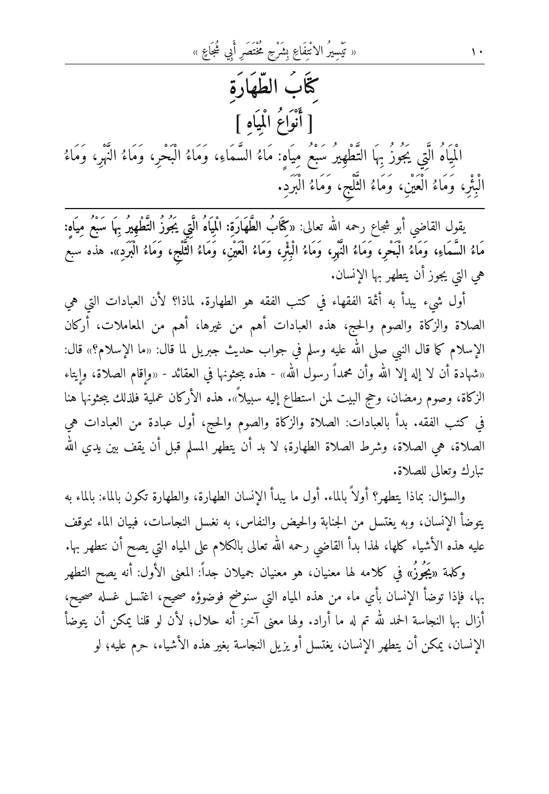
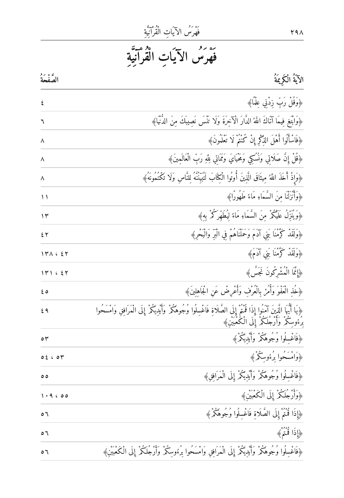
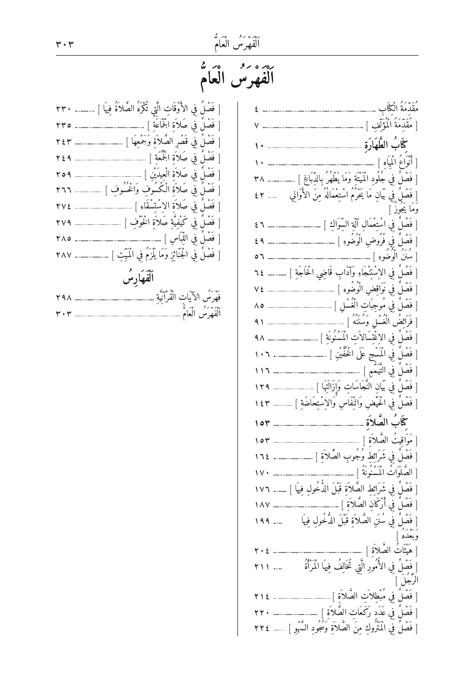

# تَيْسِيرُ الانْتِفَاعِ بِشَرْحِ مُخْتَصَرِ أَبِي شُجَاعٍ — لِفَضِيلَةِ الشَّيْخِ أَحْمَدَ الْجَوْهَرِيِّ
### التَّفْرِيغُ الْحَرْفِيُّ الْكَامِلُ الْمُرَاجَعُ لِشَرْحِ مَتْنِ الْغَايَةِ وَالتَّقْرِيبِ — (٣٠٣ صَفْحَةً — ٩٦,٣٩٩ كَلِمَةً)

[](#٥-جدول-اللقاءات-الصوتية-الخمسة-والعشرين-وروابطها-الكاملة)
[](./تيسير_الانتفاع_بشرح_مختصر_أبي_شجاع.pdf)
[](#٤-منهج-العمل-والخطوات-التفصيلية-الكاملة-من-البداية-إلى-النهاية)
[](./book_engine/book_data.json)

---

## ١. نبذة تعريفية بالمشروع

يضم هذا المستودع كتاب **«تَيْسِيرُ الانْتِفَاعِ بِشَرْحِ مُخْتَصَرِ أَبِي شُجَاعٍ»**، وهو **التفريغ الحرفي الكامل والمراجع لسلسلة شرح متن الغاية والتقريب (متن أبي شجاع في الفقه الشافعي)** لفضيلة الشيخ **أحمد الجوهري عبد الجواد** (حفظه الله تعالى)، بواقع **٢٥ لقاءً صوتياً ومرئياً** تغطي:
1. **مُقَدِّمَةُ الْكِتَابِ** (مسترسلة كاملة بلا تقسيم فيما قبل قول القاضي أبي شجاع، ص ٤ – ٦)
2. **مُقَدِّمَةُ الْمُؤَلِّفِ** (البسملة وخطبة القاضي أبي شجاع وشرحها، ص ٧ – ٩)
3. **كِتَابُ الطَّهَارَةِ** كاملاً (اللقاءات ١ – ١٢، ص ١٠ – ١٥٢)
4. **كِتَابُ الصَّلاَةِ** كاملاً شاملاً فصل الجنائز وما يلزم في الميت (اللقاءات ١٣ – ٢٥، ص ١٥٣ – ٢٩٧)
5. **فَهْرَسُ الآيَاتِ الْقُرْآنِيَّةِ وَالْفَهْرَسُ الْعَامُّ** (ص ٢٩٨ – ٣٠٣)

وقد أُعِدَّ هذا العمل عبر مراحل متكاملة شملت **التفريغ الصوتي الدقيق من التسجيلات ذات الجودة الضعيفة**، ثم **المراجعة السماعية المباشرة لإصلاح كافة مواضع التداخل أو التشويش الصوتي**، ثم **تقطيع المتن والشرح إلى ١٦٧ وحدة فقهية متناظرة دون حذف أو تلخيص أو اختصار لكلمة واحدة من كلام الشيخ (٩٦,٣٩٩ كلمة صافية)**، وأخيراً **بناء محرك صفّ طباعي آلي يخرج الكتاب بنسق المتن المشكول في أعلى الصفحة مفصولاً بخط أفقي عن الشرح الحرفي الكامل تحته مع التزام عناوين المتن التراثية الأصلية وحدها دون أي عناوين مستحدثة**.

---

## ٢. جميع الروابط المباشرة والملفات الرئيسية

### أ. الروابط السحابية (YouTube & Google Docs)

| المورد | الرابط المباشر | الوصف |
| :--- | :--- | :--- |
| **قائمة تشغيل اليوتيوب الأصلية (٢٥ درساً)** | [سلسلة شرح متن أبي شجاع — الشيخ أحمد الجوهري](https://youtube.com/playlist?list=PLjR2AWKLjP8QXzoJM0ptza1ENS850YqBX) | السلسلة الصوتية/المرئية الكاملة التي تم تفريغها ومراجعتها |
| **المجلد الكامل على Google Docs (اللقاءات ١–٢٥)** | [فتح المستند الكامل على Google Docs](https://docs.google.com/document/d/1JWeLsDtlU76TSQt-uac_vmXxDf1RCLLogj3tjZsYxUE/edit) | المجلد الكامل منسقاً بخط `Amiri` واتجاه `RTL`: المقدمة مسترسلة ثم المتن المشكول في الأعلى + خط أفقي فاصل + الشرح الحرفي الكامل تحته |
| **المجلد الأول على Google Docs (مقدمة الكتاب وكتاب الطهارة: ١–١٢)** | [فتح المجلد الأول: كتاب الطهارة](https://docs.google.com/document/d/1xqRrQTK862s9p8OchjSHOBRyFbGeWxndfiY2vj3hsN8/edit) | اللقاءات ١ إلى ١٢ (مقدمة الكتاب، ومقدمة المؤلف، وكتاب الطهارة كاملاً) |
| **المجلد الثاني على Google Docs (كتاب الصلاة: ١٣–٢٥)** | [فتح المجلد الثاني: كتاب الصلاة](https://docs.google.com/document/d/167eTHwNCyjte0hrtJZQ9oCKvjBIGtjv9fkM2bFPRJ3M/edit) | اللقاءات ١٣ إلى ٢٥ (كتاب الصلاة وفصل الجنائز كاملاً) |

---

### ب. الملفات والمجلدات داخل هذا المستودع

| المسار في المستودع | المحتوى والوظيفة |
| :--- | :--- |
| [`تيسير_الانتفاع_بشرح_مختصر_أبي_شجاع.pdf`](./تيسير_الانتفاع_بشرح_مختصر_أبي_شجاع.pdf) | **النسخة الطباعية النهائية الكاملة (PDF — ٣٠٣ صفحة — مقاس ١٦٢×٢٣٤ مم)** جاهزة للقراءة والطباعة |
| [`index.html`](./index.html) / [`viewer/matn_abi_shuja_transcripts.html`](./viewer/matn_abi_shuja_transcripts.html) | **القارئ التفاعلي لصفحات الكتاب الـ ٣٠٣** (يعمل مباشرة في المتصفح وعلى GitHub Pages مع البحث والفهرس ومشغل الفيديو) |
| [`تيسير_الانتفاع_بشرح_مختصر_أبي_شجاع/`](./تيسير_الانتفاع_بشرح_مختصر_أبي_شجاع/) | **النسخ النصية المنسقة (Markdown) + نسخة PDF**: تشمل المجلد الكامل، والمجلدين الأول والثاني، وملفات اللقاءات الـ ٢٥ المستقلة |
| [`تفريغ_كامل_مجرد_كما_ذكر/`](./تفريغ_كامل_مجرد_كما_ذكر/) | **التفريغ الحرفي الخام المجرد (٢٥ ملف `.txt` + المجلد الجامع)** كما نطق به الشيخ قبل التقطيع المطبعي بعد مراجعة الصوت |
| [`clean_lessons/`](./clean_lessons/) | **ملفات الوحدات المحققة (`L01.txt` .. `L25.txt`)**: مقسمة إلى ١٦٧ مقطعاً (`@@UNIT`، `TOC_BOOK`، `TOC_FASL`، `MATN`، `@@SHARH`) مع ضبط الآيات وإبراز ألفاظ المتن |
| [`تفريغ_شرح_متن_أبي_شجاع/`](./تفريغ_شرح_متن_أبي_شجاع/) | نسخة دراسية مساندة مرتبة للدروس الخمسة والعشرين |
| [`book_engine/`](./book_engine/) | **محرك الإخراج الطباعي (Typesetting Engine)**: القالب الطباعي، سكريبت التحزيم، محرك التقسيم الثنائي للصفحات عبر Chromium CDP، والملف المصدري `full_book.html` |
| [`scripts/`](./scripts/) | أدوات التحقق والمزامنة: `verify_verbatim.py`، `build_viewer.py`، `update_gdocs_fath.py` |
| [`docs/SUMMARY.md`](./docs/SUMMARY.md) و[`docs/WORKFLOW_AND_STEPS.md`](./docs/WORKFLOW_AND_STEPS.md) | **ملخص النسخة والدليل التفصيلي الكامل لجميع الخطوات التقنية والمنهجية والتعليمات** |

---

## ٣. نماذج مصورة من صفحات الكتاب المطبوع (٣٠٣ صفحات)

| صفحة الغلاف المزدوج الإطار (ص ١) | صفحة بيانات الطبعة ورموز الضبط (ص ٢) |
| :---: | :---: |
|  |  |

| مقدمة الكتاب مسترسلة بلا تقسيم (ص ٤) | مقدمة المؤلف والبسملة بخط المصحف (ص ٧) |
| :---: | :---: |
|  |  |

| مفتتح كتاب الطهارة وأنواع المياه (ص ١٠) | صفحة متابعة الشرح بعلامة النقاط وتباعد طبيعي (ص ١١) |
| :---: | :---: |
|  |  |

| تتابع المقاطع مع النجوم الزخرفية الثمانية (ص ١٣) | مفتتح كتاب الصلاة ومواقيتها (ص ١٥٣) |
| :---: | :---: |
|  |  |

| فهرس الآيات القرآنية (ص ٢٩٨) | الفهرس العام بنظام العمودين المتناظرين (ص ٣٠٣) |
| :---: | :---: |
|  |  |

---

## ٤. منهج العمل والخطوات التفصيلية الكاملة من البداية إلى النهاية

مرّ إنجاز هذا المشروع وإخراجه في صورته النهائية عبر **سبع مراحل متكاملة** استجابةً لجميع الطلبات والمراجعات في المحادثة:

### المرحلة الأولى: سحب الصوتيات وتفريغ السلسلة الكاملة (٢٥ درساً) مع معالجة ضعف جودة الصوت
1. **استخراج بيانات قائمة التشغيل**: تم جلب بيانات قائمة التشغيل الكاملة (`PLjR2AWKLjP8QXzoJM0ptza1ENS850YqBX`) وتحديد الدروس الـ ٢٥ بمددها الزمنية (إجمالي يزيد على ٢٠ ساعة صوتية).
2. **التفريغ الصوتي الأولي (Raw Verbatim ASR)**: تم تنزيل المسارات الصوتية للدروس الـ ٢٥ وتفريغها تفريغاً حرفياً كاملاً في مجلد [`تفريغ_كامل_مجرد_كما_ذكر/`](./تفريغ_كامل_مجرد_كما_ذكر/) بحيث يُثبت كل ما نطق به الشيخ حرفياً دون تلخيص.

### المرحلة الثانية: المراجعة السماعية المباشرة وإصلاح مواضع التشويش في التسجيلات
بسبب ضعف جودة الصوت في بعض التسجيلات الأصلية وتداخله في بعض الدقائق، أُجري فحص آلي وسماعي شامل لجميع الملفات الـ ٢٥ للكشف عن أي هلوسة نصية أو حروف لاتينية أو تكرار ناتج عن نموذج التفريغ الآلي:
- **اللقاء الأول (`lesson_01.m4a` - الدقيقة `15:50`)**: استبدال التشويش الصوتي بالعبارة المنطوقة الحقيقية بعد سماع المقطع: *«أستاذ أبو الحسن اتفضل»*.
- **اللقاء الثاني (`lesson_02.m4a` - الدقيقة `26:35`)**: استعادة الجملة المشوشة من التسجيل الصوتي مباشرةً: *«مما يستغني عنه الماء... ويقاس عليه كل ما يوافقه في علته»*.
- **اللقاء السابع (`lesson_07.m4a` - الدقيقة `09:05–10:15`)**: إصلاح تكرار عبارة ناتج عن صدى الصوت في المسجد وإثبات كلام الشيخ الفعلي كلمةً بكلمة حول حكم الجلوس في المسجد للجنب والحائض.
- **اللقاء التاسع (`lesson_09.m4a` - الدقيقتان `10:40` و`32:10`)**: استعادة الكلمات المشوشة من الصوت مباشرةً في مبحث المسح على الخفين.
- **اللقاء العاشر (`lesson_10.m4a` - الدقيقة `53:10–55:10`)**: استماع مباشر للمقطع الخاص بالجبيرة واستعادة النص الكامل: *«والجزء المستمسك اللي هو لا بد منه لكي نربط الرباط...»*، مع الحفاظ التام على جملة الشيخ في مسألة نية التيمم.
- **اللقاء الثالث عشر (`lesson_13.m4a` - الدقيقة `27:55`)**: إصلاح التداخل الصوتي إلى نصه الصحيح المنطوق: *«في جمع التقديم وجمع التأخير»*.

### المرحلة الثالثة: التحقيق النصي والمطابقة الصارمة (`verify_verbatim.py`)
تمت كتابة أداة فحص صارمة [`scripts/verify_verbatim.py`](./scripts/verify_verbatim.py) تقارن كل كلمة في الملفات المحققة [`clean_lessons/L01.txt`](./clean_lessons/L01.txt) .. [`L25.txt`](./clean_lessons/L25.txt) بالتفريغ الخام للتأكد من:
1. **عدم سقوط أي جملة أو فقرة** (`0` فجوات تزيد على ١٨ كلمة في جميع الدروس الـ ٢٥ بدون استثناء، مع اجتياز `25/25 PASS`).
2. **خلو النص تماماً من أي أحرف أجنبية أو رموز مشوهة**.
3. **تقسيم كل درس إلى وحدات متناظرة (`167` مقطعاً فقهياً)** بحيث يوضع جزء المتن المشكول أولاً وتحته شرح الشيخ الحرفي الكامل لهذا المقطع بالذات.

### المرحلة الرابعة: محرك الصفّ الطباعي وضوابط الإخراج العلمي (`book_engine/`)
تم ضبط كافة المعايير الطباعية في [`book_engine/template_book.html`](./book_engine/template_book.html) و[`book_engine/render_book.mjs`](./book_engine/render_book.mjs) وفق التنقيحات النهائية:
1. **مقاس الصفحة الكلاسيكي (`162mm × 234mm`)**: بهامش علمي متوازن (`13mm` أعلى، `19mm` يمين ويسار، `17mm` أسفل) وأطر مزدوجة للصفحات الثلاث الافتتاحية (`2.2pt` خارجي، `0.75pt` داخلي).
2. **لوحات البداية المنقاة (ص ١–٣)**:
   - **صفحة العنوان (ص ١)**: تحمل العنوان المعتمد **`تَيْسِيرُ الانْتِفَاعِ بِشَرْحِ مُخْتَصَرِ أَبِي شُجَاعٍ`**، ولقب الشارح **`لِفَضِيلَةِ الشَّيْخِ أَحْمَدَ الْجَوْهَرِيِّ عَبْدِ الْجَوَادِ`**.
   - **صفحة بيانات النسخة ورموز الضبط (ص ٢)** ثم **لوحة البسملة المستقلة (ص ٣)** — مع حذف فهرس اللقاءات الصوتية وترجمة المصنف المصطنعة من مقدمة الكتاب وكافة الإحالات لطبعات أخرى.
3. **استرسال «مُقَدِّمَةُ الْكِتَابِ» (ص ٤–٦)**: جميع ما قبل قول المصنف *«قَالَ الْقَاضِي أَبُو شُجَاعٍ»* أُفرد كمقدمة مسترسلة للكتاب بدءاً من الصفحة الرابعة بدون قسم علوي للمتن وبدون خط تقسيم؛ وتبدأ البسملة ومتن القاضي أبي شجاع من `[ مُقَدِّمَةُ الْمُؤَلِّفِ ]` (ص ٧).
4. **الاقتصار على عناوين المتن التراثية الأصلية وحدها**: حذف كافة العناوين المستحدثة (`كِتَابُ أَحْكَامِ...` وعناوين المقاطع الفرعية وترويسات الشرح أسفل الخط الفاصل)، وإثبات عناوين المتن الحقيقية فقط (`كِتَابُ الطَّهَارَةِ`، `كِتَابُ الصَّلاَةِ`، وعناوين الأبواب والفصول المعقوفة `[ ... ]`).
5. **منطقتا المتن والشرح وعلامة المتابعة (`............................................`)**:
   - **منطقة المتن (`.matn-zone`)**: نص المتن مضبوطاً بالشكل الكامل بخط `Amiri` (`13.4pt`) فوق الخط الفاصل الأفقي (`0.75pt`).
   - **صفحات المتابعة الممتدة**: عند امتداد الشرح على أكثر من صفحة لموضع واحد من المتن، يوضع أعلى الخط الفاصل صف من النقاط المتتالية (`............................................`) بدلاً من تكرار المتن أو كتابة عبارة متابعة.
   - **المحاذاة الطبيعية لآخر سطر في كل شطر صفحة**: إزالة التمديد القسري للسطر الأخير (`text-align-last: right`) حتى لا تتباعد الكلمات عن بعضها بشكل مشوه في نهاية أي صفحة.
   - **تتابع المسائل القصيرة**: تُفصل المقاطع المتتابعة في الصفحة الواحدة بثلاث نجوم ثمانية البتلات `✽  ✽  ✽` في المتن والشرح معاً، وتُبرَز ألفاظ المتن داخل الشرح بالخط العريض (`<strong>`) والآيات القرآنية بخط المصحف بين القوسين `﴿ ... ﴾`.
6. **الفهارس العلمية الآلية في خاتمة الكتاب (ص ٢٩٨–٣٠٣)**:
   - **فهرس الآيات القرآنية (ص ٢٩٨–٣٠٢)**.
   - **الفهرس العام بنظام العمودين المتناظرين (ص ٣٠٣)** مع الخط العمودي الفاصل والنقاط القائدة وأرقام الصفحات المشرقية.

### المرحلة الخامسة: بناء القارئ التفاعلي لصفحات الكتاب (`index.html`)
تم بناء وتحديث القارئ التفاعلي [`index.html`](./index.html) ليستعرض الصفحات الـ ٣٠٣ بتصميمها الطباعي الأصلي، مع فهرس جانبي لجميع اللقاءات الـ ٢٥ والفهارس، وبحث فوري في كامل النص (`96,399` كلمة)، وانتقال مباشر لأي صفحة، والتبديل بين عرض الكتاب المنسق والنص الحرفي الخام ومشغل الفيديو المدمج وتغيير لون الورق.

### المرحلة السادسة: توليد كتب الماركداون المنظمة ومزامنة مستندات Google Docs الثلاثة
1. تحديث كافة ملفات الماركداون والكتب المجمعة في مجلد [`تيسير_الانتفاع_بشرح_مختصر_أبي_شجاع/`](./تيسير_الانتفاع_بشرح_مختصر_أبي_شجاع/).
2. تحديث المستندات الثلاثة على Google Docs عبر [`scripts/update_gdocs_fath.py`](./scripts/update_gdocs_fath.py) وإعادة تسميتها في Google Drive بالعنوان الجديد المعتمد، مع المقدمة المسترسلة والعناوين الأصلية للمتن فقط وإلغاء جدول اللقاءات الافتتاحي وضبط اتجاه الفقرات الكامل من اليمين إلى اليسار (`RIGHT_TO_LEFT`).

---

## ٥. جدول اللقاءات الصوتية الخمسة والعشرين وروابطها الكاملة

| م | موضوع اللقاء التفصيلي | المدة | الكلمات | الصفحات في PDF | ملف الدرس (Markdown) | ملف الوحدات المحقق | التفريغ الخام المجرد | رابط اليوتيوب |
| :-: | :--- | :-: | :-: | :-: | :---: | :---: | :---: | :---: |
| **١** | مقدمة الكتاب، ومقدمة المؤلف، وكتاب الطهارة (أنواع المياه) | ٧٣ د | 6,004 | ص ٤ – ٢٤ | [عرض الدرس](./تيسير_الانتفاع_بشرح_مختصر_أبي_شجاع/01_الدرس_الأول_مقدمة_الكتاب_وأنواع_المياه_وأقسامها.md) | [L01](./clean_lessons/L01.txt) | [النص الخام](./تفريغ_كامل_مجرد_كما_ذكر/01_الدرس_الأول_نص_مجرد_كامل.txt) | [🎥 يوتيوب](https://www.youtube.com/watch?v=XNOZOX88_TE) |
| **٢** | تتمة أقسام المياه، وأحكام الماء النجس ومقدار القلتين | ٥٤ د | 4,439 | ص ٢٥ – ٣٧ | [عرض الدرس](./تيسير_الانتفاع_بشرح_مختصر_أبي_شجاع/02_الدرس_الثاني_الماء_النجس_ومقدار_القلتين.md) | [L02](./clean_lessons/L02.txt) | [النص الخام](./تفريغ_كامل_مجرد_كما_ذكر/02_الدرس_الثاني_نص_مجرد_كامل.txt) | [🎥 يوتيوب](https://www.youtube.com/watch?v=8PbuyNDIE8I) |
| **٣** | طهارة الجلود بالدباغ، وأحكام الأواني، وفصل السواك | ٥٣ د | 3,682 | ص ٣٨ – ٤٨ | [عرض الدرس](./تيسير_الانتفاع_بشرح_مختصر_أبي_شجاع/03_الدرس_الثالث_الدباغ_والأواني_والسواك.md) | [L03](./clean_lessons/L03.txt) | [النص الخام](./تفريغ_كامل_مجرد_كما_ذكر/03_الدرس_الثالث_نص_مجرد_كامل.txt) | [🎥 يوتيوب](https://www.youtube.com/watch?v=F0Lj_OraMsM) |
| **٤** | فرائض الوضوء الستة وسننه العشرة | ٦١ د | 4,599 | ص ٤٩ – ٦١ | [عرض الدرس](./تيسير_الانتفاع_بشرح_مختصر_أبي_شجاع/04_الدرس_الرابع_فرائض_الوضوء_وسننه.md) | [L04](./clean_lessons/L04.txt) | [النص الخام](./تفريغ_كامل_مجرد_كما_ذكر/04_الدرس_الرابع_نص_مجرد_كامل.txt) | [🎥 يوتيوب](https://www.youtube.com/watch?v=dSNEfyecEJM) |
| **٥** | تتمة سنن الوضوء، وأحكام الاستنجاء وآداب قاضي الحاجة | ٥٤ د | 4,195 | ص ٦٢ – ٧٣ | [عرض الدرس](./تيسير_الانتفاع_بشرح_مختصر_أبي_شجاع/05_الدرس_الخامس_تتمة_سنن_الوضوء_والاستطابة_وآداب_الخلاء.md) | [L05](./clean_lessons/L05.txt) | [النص الخام](./تفريغ_كامل_مجرد_كما_ذكر/05_الدرس_الخامس_نص_مجرد_كامل.txt) | [🎥 يوتيوب](https://www.youtube.com/watch?v=MS_ggWejJ_c) |
| **٦** | فصل نواقض الوضوء الستة | ٤٧ د | 3,699 | ص ٧٤ – ٨٤ | [عرض الدرس](./تيسير_الانتفاع_بشرح_مختصر_أبي_شجاع/06_الدرس_السادس_نواقض_الوضوء_الستة.md) | [L06](./clean_lessons/L06.txt) | [النص الخام](./تفريغ_كامل_مجرد_كما_ذكر/06_الدرس_السادس_نص_مجرد_كامل.txt) | [🎥 يوتيوب](https://www.youtube.com/watch?v=2fDdOCKeDSo) |
| **٧** | موجبات الغسل الستة، وفرائض الغسل وسننه | ٥٩ د | 4,439 | ص ٨٥ – ٩٧ | [عرض الدرس](./تيسير_الانتفاع_بشرح_مختصر_أبي_شجاع/07_الدرس_السابع_موجبات_الغسل_وفرائضه_وسننه.md) | [L07](./clean_lessons/L07.txt) | [النص الخام](./تفريغ_كامل_مجرد_كما_ذكر/07_الدرس_السابع_نص_مجرد_كامل.txt) | [🎥 يوتيوب](https://www.youtube.com/watch?v=IxmQMfJm4Hw) |
| **٨** | فصل الاغتسالات المسنونة السبعة عشر | ٤٢ د | 2,684 | ص ٩٨ – ١٠٥ | [عرض الدرس](./تيسير_الانتفاع_بشرح_مختصر_أبي_شجاع/08_الدرس_الثامن_الأغسال_المسنونة_السبعة_عشر.md) | [L08](./clean_lessons/L08.txt) | [النص الخام](./تفريغ_كامل_مجرد_كما_ذكر/08_الدرس_الثامن_نص_مجرد_كامل.txt) | [🎥 يوتيوب](https://www.youtube.com/watch?v=2IVULUVrTio) |
| **٩** | فصل المسح على الخفين وشرائطه ومدته ومبطلاته | ٤٤ د | 3,191 | ص ١٠٦ – ١١٥ | [عرض الدرس](./تيسير_الانتفاع_بشرح_مختصر_أبي_شجاع/09_الدرس_التاسع_أحكام_المسح_على_الخفين.md) | [L09](./clean_lessons/L09.txt) | [النص الخام](./تفريغ_كامل_مجرد_كما_ذكر/09_الدرس_التاسع_نص_مجرد_كامل.txt) | [🎥 يوتيوب](https://www.youtube.com/watch?v=b886hsfRkqA) |
| **١٠** | فصل التيمم وشرائطه وفرائضه وسننه ومبطلاته وحكم الجبائر | ٥٧ د | 3,801 | ص ١١٦ – ١٢٦ | [عرض الدرس](./تيسير_الانتفاع_بشرح_مختصر_أبي_شجاع/10_الدرس_العاشر_أحكام_التيمم_وشروطه_وفرائضه.md) | [L10](./clean_lessons/L10.txt) | [النص الخام](./تفريغ_كامل_مجرد_كما_ذكر/10_الدرس_العاشر_نص_مجرد_كامل.txt) | [🎥 يوتيوب](https://www.youtube.com/watch?v=fSZz4SWvWwE) |
| **١١** | تتمة أحكام صاحب الجبائر، وفصل النجاسات وإزالتها | ٦٢ د | 4,772 | ص ١٢٧ – ١٤٠ | [عرض الدرس](./تيسير_الانتفاع_بشرح_مختصر_أبي_شجاع/11_الدرس_الحادي_عشر_النجاسات_وكيفية_تطهيرها.md) | [L11](./clean_lessons/L11.txt) | [النص الخام](./تفريغ_كامل_مجرد_كما_ذكر/11_الدرس_الحادي_عشر_نص_مجرد_كامل.txt) | [🎥 يوتيوب](https://www.youtube.com/watch?v=ZN9gepII_to) |
| **١٢** | تتمة النجاسات، وفصل الحيض والنفاس والاستحاضة ومحرماتها | ٥٤ د | 3,624 | ص ١٤١ – ١٥٢ | [عرض الدرس](./تيسير_الانتفاع_بشرح_مختصر_أبي_شجاع/12_الدرس_الثاني_عشر_الحيض_والنفاس_والاستحاضة.md) | [L12](./clean_lessons/L12.txt) | [النص الخام](./تفريغ_كامل_مجرد_كما_ذكر/12_الدرس_الثاني_عشر_نص_مجرد_كامل.txt) | [🎥 يوتيوب](https://www.youtube.com/watch?v=ogNG2R1gtvc) |
| **١٣** | كتاب الصلاة وتفصيل مواقيت الصلوات الخمس المفروضة | ٤٨ د | 3,814 | ص ١٥٣ – ١٦٣ | [عرض الدرس](./تيسير_الانتفاع_بشرح_مختصر_أبي_شجاع/13_الدرس_الثالث_عشر_كتاب_الصلاة_ومواقيتها.md) | [L13](./clean_lessons/L13.txt) | [النص الخام](./تفريغ_كامل_مجرد_كما_ذكر/13_الدرس_الثالث_عشر_نص_مجرد_كامل.txt) | [🎥 يوتيوب](https://www.youtube.com/watch?v=iFyYlUyLIjE) |
| **١٤** | شرائط وجوب الصلاة، والصلوات المسنونة والسنن الرواتب | ٤٩ د | 3,769 | ص ١٦٤ – ١٧٥ | [عرض الدرس](./تيسير_الانتفاع_بشرح_مختصر_أبي_شجاع/14_الدرس_الرابع_عشر_شرائط_وجوب_الصلاة_والسنن_الرواتب.md) | [L14](./clean_lessons/L14.txt) | [النص الخام](./تفريغ_كامل_مجرد_كما_ذكر/14_الدرس_الرابع_عشر_نص_مجرد_كامل.txt) | [🎥 يوتيوب](https://www.youtube.com/watch?v=FmG1dhgHGdM) |
| **١٥** | فصل شرائط الصلاة قبل الدخول فيها | ٤٢ د | 3,691 | ص ١٧٦ – ١٨٦ | [عرض الدرس](./تيسير_الانتفاع_بشرح_مختصر_أبي_شجاع/15_الدرس_الخامس_عشر_شرائط_صحة_الصلاة_الخمسة.md) | [L15](./clean_lessons/L15.txt) | [النص الخام](./تفريغ_كامل_مجرد_كما_ذكر/15_الدرس_الخامس_عشر_نص_مجرد_كامل.txt) | [🎥 يوتيوب](https://www.youtube.com/watch?v=DsHfwqvZd-0) |
| **١٦** | فصل أركان الصلاة الثمانية عشر | ٥٦ د | 3,993 | ص ١٨٧ – ١٩٨ | [عرض الدرس](./تيسير_الانتفاع_بشرح_مختصر_أبي_شجاع/16_الدرس_السادس_عشر_أركان_الصلاة_الثمانية_عشر.md) | [L16](./clean_lessons/L16.txt) | [النص الخام](./تفريغ_كامل_مجرد_كما_ذكر/16_الدرس_السادس_عشر_نص_مجرد_كامل.txt) | [🎥 يوتيوب](https://www.youtube.com/watch?v=OXcmcyhZjXk) |
| **١٧** | فصل سنن الصلاة وأبعاضها وهيئاتها الخمس عشرة | ٥٥ د | 3,997 | ص ١٩٩ – ٢١٠ | [عرض الدرس](./تيسير_الانتفاع_بشرح_مختصر_أبي_شجاع/17_الدرس_السابع_عشر_سنن_الصلاة_وأبعاضها_وهيئاتها.md) | [L17](./clean_lessons/L17.txt) | [النص الخام](./تفريغ_كامل_مجرد_كما_ذكر/17_الدرس_السابع_عشر_نص_مجرد_كامل.txt) | [🎥 يوتيوب](https://www.youtube.com/watch?v=eQ3AYmdm2U8) |
| **١٨** | ما تخالف فيه المرأة الرجل، ومبطلات الصلاة، وإحصاء ركعات الفرائض | ٤٢ د | 3,267 | ص ٢١١ – ٢٢٠ | [عرض الدرس](./تيسير_الانتفاع_بشرح_مختصر_أبي_شجاع/18_الدرس_الثامن_عشر_مخالفة_المرأة_للرجل_ومبطلات_الصلاة_وإحصاء_الركعات.md) | [L18](./clean_lessons/L18.txt) | [النص الخام](./تفريغ_كامل_مجرد_كما_ذكر/18_الدرس_الثامن_عشر_نص_مجرد_كامل.txt) | [🎥 يوتيوب](https://www.youtube.com/watch?v=ffya00W_gSE) |
| **١٩** | صلاة العاجز عن القيام، وفصل المتروك من الصلاة وسجود السهو | ٣٦ د | 2,911 | ص ٢٢١ – ٢٢٩ | [عرض الدرس](./تيسير_الانتفاع_بشرح_مختصر_أبي_شجاع/19_الدرس_التاسع_عشر_صلاة_العاجز_وسجود_السهو.md) | [L19](./clean_lessons/L19.txt) | [النص الخام](./تفريغ_كامل_مجرد_كما_ذكر/19_الدرس_التاسع_عشر_نص_مجرد_كامل.txt) | [🎥 يوتيوب](https://www.youtube.com/watch?v=G3JxD3peqIA) |
| **٢٠** | الأوقات التي تكره فيها الصلاة، وفصل صلاة الجماعة | ٣٩ د | 3,053 | ص ٢٣٠ – ٢٣٨ | [عرض الدرس](./تيسير_الانتفاع_بشرح_مختصر_أبي_شجاع/20_الدرس_العشرون_الأوقات_المكروهة_وصلاة_الجماعة.md) | [L20](./clean_lessons/L20.txt) | [النص الخام](./تفريغ_كامل_مجرد_كما_ذكر/20_الدرس_العشرون_نص_مجرد_كامل.txt) | [🎥 يوتيوب](https://www.youtube.com/watch?v=mfY_MLEYuyc) |
| **٢١** | تتمة صلاة الجماعة، وفصل قصر الصلاة وجمعها للمسافر والحاضر | ٣٨ د | 3,049 | ص ٢٣٩ – ٢٤٨ | [عرض الدرس](./تيسير_الانتفاع_بشرح_مختصر_أبي_شجاع/21_الدرس_الحادي_والعشرون_تتمة_الجماعة_وقصر_الصلاة_وجمعها.md) | [L21](./clean_lessons/L21.txt) | [النص الخام](./تفريغ_كامل_مجرد_كما_ذكر/21_الدرس_الحادي_والعشرون_نص_مجرد_كامل.txt) | [🎥 يوتيوب](https://www.youtube.com/watch?v=pwvD4q1rAaQ) |
| **٢٢** | فصل صلاة الجمعة وشرائطها وفرائضها وهيئاتها | ٤١ د | 3,310 | ص ٢٤٩ – ٢٥٨ | [عرض الدرس](./تيسير_الانتفاع_بشرح_مختصر_أبي_شجاع/22_الدرس_الثاني_والعشرون_أحكام_صلاة_الجمعة.md) | [L22](./clean_lessons/L22.txt) | [النص الخام](./تفريغ_كامل_مجرد_كما_ذكر/22_الدرس_الثاني_والعشرون_نص_مجرد_كامل.txt) | [🎥 يوتيوب](https://www.youtube.com/watch?v=ZVpM73bVtYc) |
| **٢٣** | فصل صلاة العيدين والتكبير، ومقدمة صلاة الكسوف والخسوف | ٤٨ د | 3,996 | ص ٢٥٩ – ٢٧٠ | [عرض الدرس](./تيسير_الانتفاع_بشرح_مختصر_أبي_شجاع/23_الدرس_الثالث_والعشرون_صلاة_العيدين_ومقدمة_الكسوف.md) | [L23](./clean_lessons/L23.txt) | [النص الخام](./تفريغ_كامل_مجرد_كما_ذكر/23_الدرس_الثالث_والعشرون_نص_مجرد_كامل.txt) | [🎥 يوتيوب](https://www.youtube.com/watch?v=ZWA0LRV7tN0) |
| **٢٤** | تفصيل صلاة الكسوفين، وفصل الاستسقاء، وفصل صلاة الخوف | ٥١ د | 4,199 | ص ٢٧١ – ٢٨٤ | [عرض الدرس](./تيسير_الانتفاع_بشرح_مختصر_أبي_شجاع/24_الدرس_الرابع_والعشرون_الكسوف_والاستسقاء_وصلاة_الخوف.md) | [L24](./clean_lessons/L24.txt) | [النص الخام](./تفريغ_كامل_مجرد_كما_ذكر/24_الدرس_الرابع_والعشرون_نص_مجرد_كامل.txt) | [🎥 يوتيوب](https://www.youtube.com/watch?v=neMm3Z_cpq4) |
| **٢٥** | فصل اللباس والحرير والذهب، وفصل الجنائز وما يلزم في الميت | ٥٤ د | 4,221 | ص ٢٨٥ – ٢٩٧ | [عرض الدرس](./تيسير_الانتفاع_بشرح_مختصر_أبي_شجاع/25_الدرس_الخامس_والعشرون_أحكام_اللباس_والجنائز.md) | [L25](./clean_lessons/L25.txt) | [النص الخام](./تفريغ_كامل_مجرد_كما_ذكر/25_الدرس_الخامس_والعشرون_نص_مجرد_كامل.txt) | [🎥 يوتيوب](https://www.youtube.com/watch?v=Q_gKWS08RXo) |

---

## ٦. تعليمات التشغيل وإعادة البناء والتوليد

إذا رغبت في تعديل أي نص في `clean_lessons/` وإعادة توليد الكتاب المطبوع (PDF) وملفات الماركداون والقارئ التفاعلي، اتبع الأوامر التالية بالترتيب:

### ١. التحقق من مطابقة النصوص المحققة للتفريغ الحرفي الخام
```bash
python3 scripts/verify_verbatim.py
```

### ٢. بناء قاعدة بيانات الكتاب المهيكلة (`book_data.json`)
```bash
python3 book_engine/build_book_data.py book_engine/book_data.json
```

### ٣. تحديث جميع ملفات الماركداون والمجلدات الثلاثة
```bash
python3 book_engine/update_markdown_books.py
```

### ٤. توليد نسخة الكتاب المطبوع (PDF — ٣٠٣ صفحة) والنسخة المقسمة (`full_book.html`)
```bash
node book_engine/render_book.mjs \
  book_engine/book_data.json \
  تيسير_الانتفاع_بشرح_مختصر_أبي_شجاع.pdf \
  book_engine/full_book.html
```

### ٥. تحديث القارئ التفاعلي (`index.html` و`viewer/matn_abi_shuja_transcripts.html`)
```bash
python3 scripts/build_viewer.py
```

### ٦. مزامنة وتحديث مستندات Google Docs الثلاثة
```bash
python3 scripts/update_gdocs_fath.py
```
