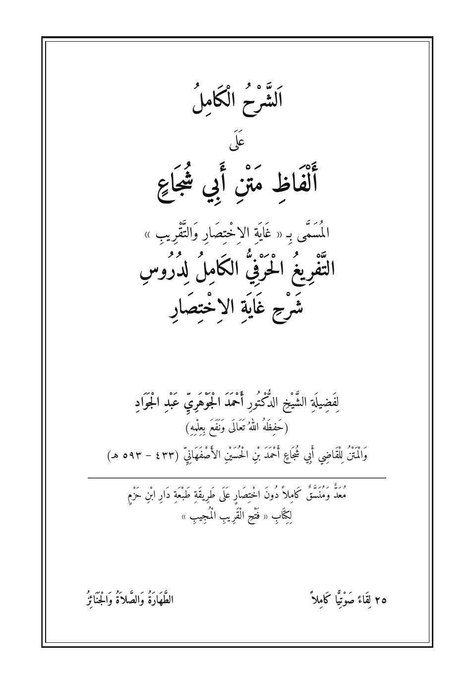
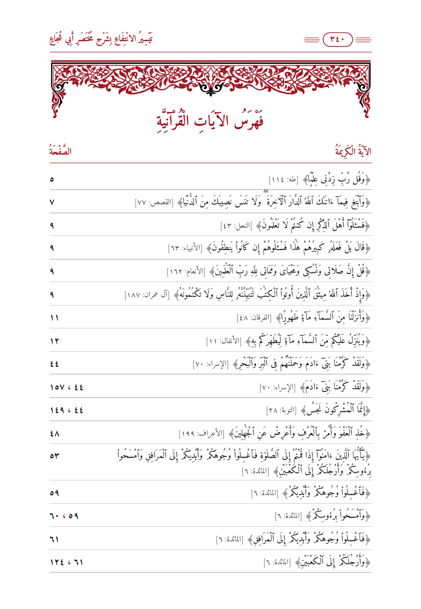

# تَيْسِيرُ الانْتِفَاعِ بِشَرْحِ مُخْتَصَرِ أَبِي شُجَاعٍ — لِفَضِيلَةِ الشَّيْخِ أَحْمَدَ الْجَوْهَرِيِّ

> **طبعتان متكاملتان (`v4.0.0`) بالتنسيق التراثي الأحمر القرمزي (`#9B111E`) والكلاسيكي (`#111111`):**
> 1. **النُّسْخَةُ الْمُحَرَّرَةُ الْمُهَذَّبَةُ (`v4.0.0` — `339` صفحة — `93,143` كلمة شرح في `167` وحدة)**: إثبات كلام الشيخ الشارح كاملاً بلفظه دون تبديل أو اختصار (`93.0%–98.1%` احتفاظاً بألفاظ كل درس)، مع الاقتصار على مقدمة اللقاء الأول وخاتمة اللقاء الأخير وتهذيب التكرار اللفظي المتتابع والتعليقات التقنية فحسب.
> 2. **النُّسْخَةُ الْحَرْفِيَّةُ الْكَامِلَةُ (`v4.0.0` — `345` صفحة — `96,630` كلمة شرح في `167` وحدة)**: تفريغ حرفي كامل ١٠٠٪ كما أُلقي بلفظه.
>
> كلاهما مضبوط بالرسم العثماني الكامل لجميع الآيات القرآنية مع مواضعها `[السورة: الآية]` (`76` آية مفهرسة)، بمقاس `162×234 مم` بالعناوين التراثية الأصيلة لمتن الغاية والتقريب مع حواشي غريب المتن منتقاةً من رسالة **«الأَنوَارُ عَلَى غَايَةِ الاِخْتِصَارِ» لِجَامِعِهِ عَبْدِ الرَّحْمَنِ مُحَمَّدٍ نُورِ الدِّينِ**، في **نسخة كلاسيكية + نسخة لونين أحمر قرمزي وأسود + ملفات Word `.docx` قابلة للتعديل + استوديو التحرير المباشر**.

---

## ١. نماذج مصورة من صفحات النسخة المحررة والنسخة الحرفية (`v4.0.0`)

| لوحة الغلاف الأمامية المذهّبة (ص ١) | صفحة العنوان باللون الأحمر القرمزي (ص ٢) | بيانات النسخة ومنهج التحرير الجديد (ص ٣) |
| :---: | :---: | :---: |
|  |  |  |

| لوحة البسملة المخطوطة والنجوم الثلاث (ص ٤) | مقدمة الكتاب بالإطار الأرابيسك القرمزي (ص ٥) | المتن والشرح المقسّمان باللون الأحمر القرمزي (ص ١٠) |
| :---: | :---: | :---: |
|  |  |  |

| فهرس الآيات القرآنية بالرسم العثماني (ص ٣٤٠) | الفهرس العام المتوازن بعمودين (ص ٣٤٥) | صفحة الفهارس المحررة (ص ٣٣٩) |
| :---: | :---: | :---: |
|  |  |  |

---

## ٢. خصائص الإخراج الطباعي النهائي (`v4.0.0`)

1. **النُّسْخَةُ الْمُحَرَّرَةُ الْمُهَذَّبَةُ (`339` صفحة — `93,143` كلمة)**: حفظ ألفاظ الشيخ وعباراته كاملةً دون تلخيص أو تبديل، مع حذف مقدمات الدروس (`L02..L25`) وخواتيمها (`L01..L24`)، وتنقية ملاحظات الصوت والتكرار اللفظي المتتابع فحسب.
2. **الهوية البصرية التراثية الجديدة (`#9B111E` قرمزي + `#111111` كلاسيكي)**:
   - لوحة الغلاف المذهّبة (`ص ١`)، فصفحة العنوان (`ص ٢`)، فالمنهجية والحواشي (`ص ٣`)، فلوحة البسملة الخطية PNG + ٣ نجوم ثمانية متجاورة (`ص ٤`).
   - راية أرابيسك قرمزية في فواتح الكتب والمقدمات والفهارس، وترويسة مجنّحة مستلّة تلقائياً من عناوين الفصول، مع تكافؤ ١:١ تماماً في عدد الصفحات (`339 == 339` للمحررة، و`345 == 345` للحرفية).
3. **القرآن الكريم بالرسم العثماني الكامل (`quran_uthmani.json`)**: جميع الآيات مخرجة برسم المصحف ومقرونة بمواضعها `[السورة: الآية]` ومفهرسة في فهرس الآيات (`76` آية).
4. **حواشي غريب المتن المستقلة لكل صفحة (`31` حاشية)** من **«الأَنوَارُ عَلَى غَايَةِ الاِخْتِصَارِ»**، واستوديو التحرير التفاعلي المباشر [`viewer/editor.html`](../viewer/editor.html).

---

## ٣. الملفات والمجلدات الرئيسية في المستودع

| الملف / المستند | الوصف | المسار |
| :--- | :--- | :--- |
| **استوديو التحرير المباشر (`HTML`)** | محرر تفاعلي متكامل لتعديل النصوص والصور وتصدير PDF | [`../viewer/editor.html`](../viewer/editor.html) |
| **النسخة المحررة الكلاسيكية (`PDF` — ٣٣٩ ص)** | إثبات كامل كلام الشيخ مهذباً، مقاس `162×234 مم` | [`../تيسير_الانتفاع_بشرح_مختصر_أبي_شجاع_النسخة_المحررة.pdf`](../تيسير_الانتفاع_بشرح_مختصر_أبي_شجاع_النسخة_المحررة.pdf) |
| **النسخة المحررة — لونين (`PDF` — ٣٣٩ ص)** | أحمر قرمزي (`#9B111E`) وأسود على أبيض | [`../تيسير_الانتفاع_بشرح_مختصر_أبي_شجاع_النسخة_المحررة/تيسير_الانتفاع_بشرح_مختصر_أبي_شجاع_النسخة_المحررة_نسخة_لونين.pdf`](../تيسير_الانتفاع_بشرح_مختصر_أبي_شجاع_النسخة_المحررة/تيسير_الانتفاع_بشرح_مختصر_أبي_شجاع_النسخة_المحررة_نسخة_لونين.pdf) |
| **ملفا Word المحررة (`.docx`)** | كلاسيكي + أحمر قرمزي قابلة للتعديل (`339` ص) | [`../تيسير_الانتفاع_بشرح_مختصر_أبي_شجاع_النسخة_المحررة/`](../تيسير_الانتفاع_بشرح_مختصر_أبي_شجاع_النسخة_المحررة/) |
| **القارئ التفاعلي للنسخة المحررة (`HTML`)** | تصفح الـ `339` صفحة مع ٣ أنماط لون والبحث | [`../viewer/matn_abi_shuja_edited.html`](../viewer/matn_abi_shuja_edited.html) |
| **النسخة الحرفية الكلاسيكية (`PDF` — ٣٤٥ ص)** | أبيض وأسود كلاسيكي مقاس `162×234 مم` | [`../تيسير_الانتفاع_بشرح_مختصر_أبي_شجاع.pdf`](../تيسير_الانتفاع_بشرح_مختصر_أبي_شجاع.pdf) |
| **النسخة الحرفية — لونين (`PDF` — ٣٤٥ ص)** | أحمر قرمزي (`#9B111E`) وأسود على أبيض | [`../تيسير_الانتفاع_بشرح_مختصر_أبي_شجاع/تيسير_الانتفاع_بشرح_مختصر_أبي_شجاع_نسخة_لونين.pdf`](../تيسير_الانتفاع_بشرح_مختصر_أبي_شجاع/تيسير_الانتفاع_بشرح_مختصر_أبي_شجاع_نسخة_لونين.pdf) |
| **ملفا Word الحرفية (`.docx`)** | كلاسيكي + أحمر قرمزي قابلة للتعديل (`345` ص) | [`../تيسير_الانتفاع_بشرح_مختصر_أبي_شجاع/`](../تيسير_الانتفاع_بشرح_مختصر_أبي_شجاع/) |
| **القارئ التفاعلي للنسخة الحرفية (`HTML`)** | يستعرض الـ `345` صفحة مع ٣ أنماط لون، والبحث، والتسجيلات | [`../index.html`](../index.html) |
