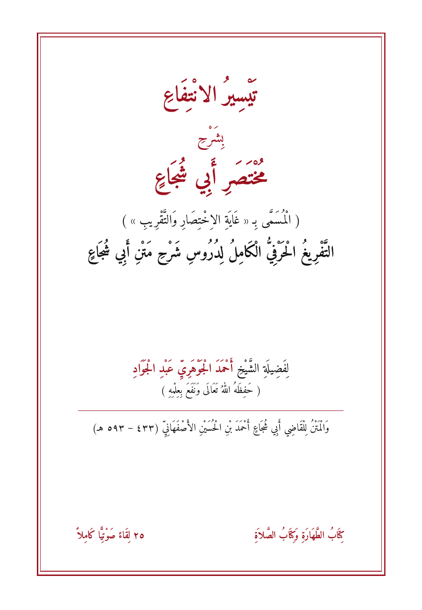
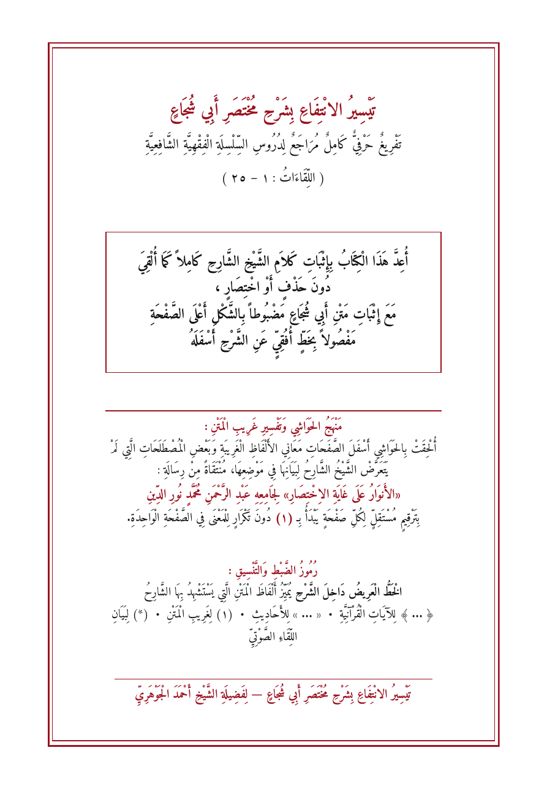
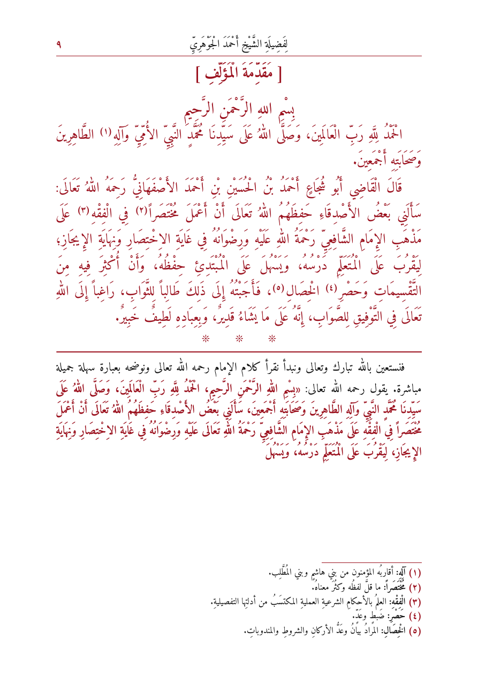
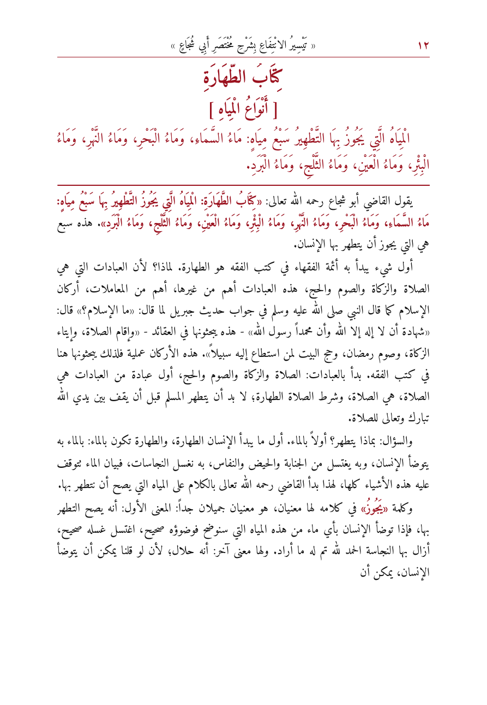
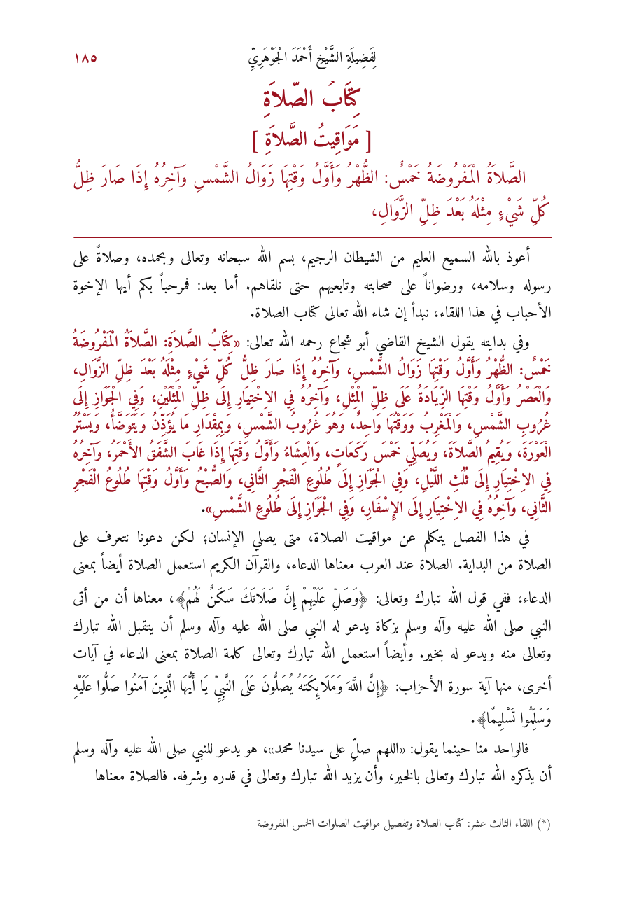
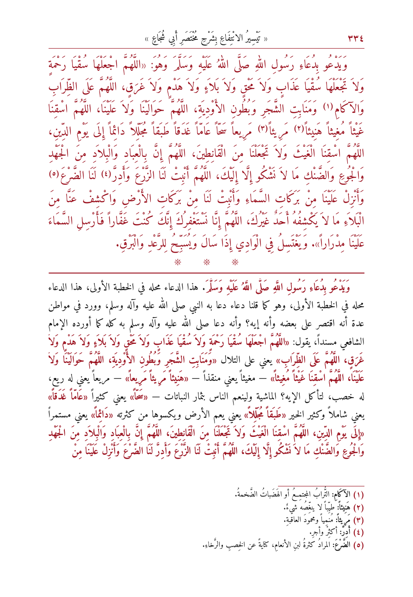
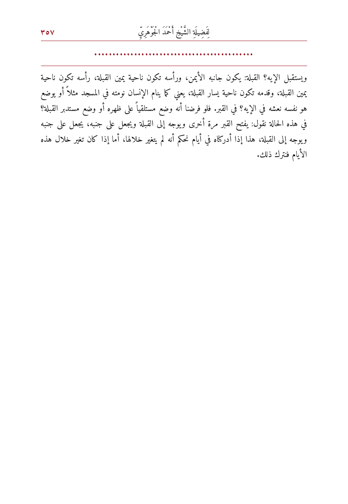
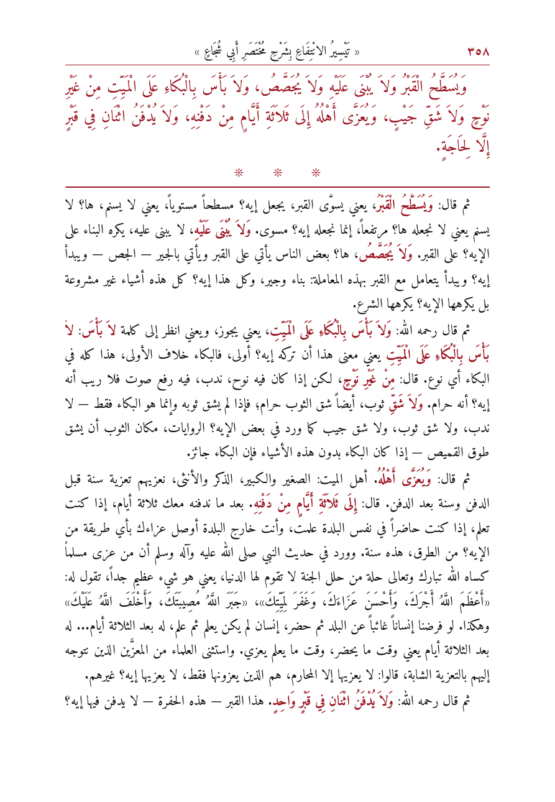
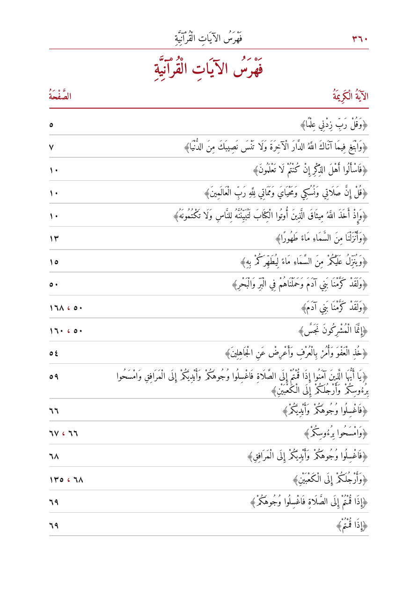
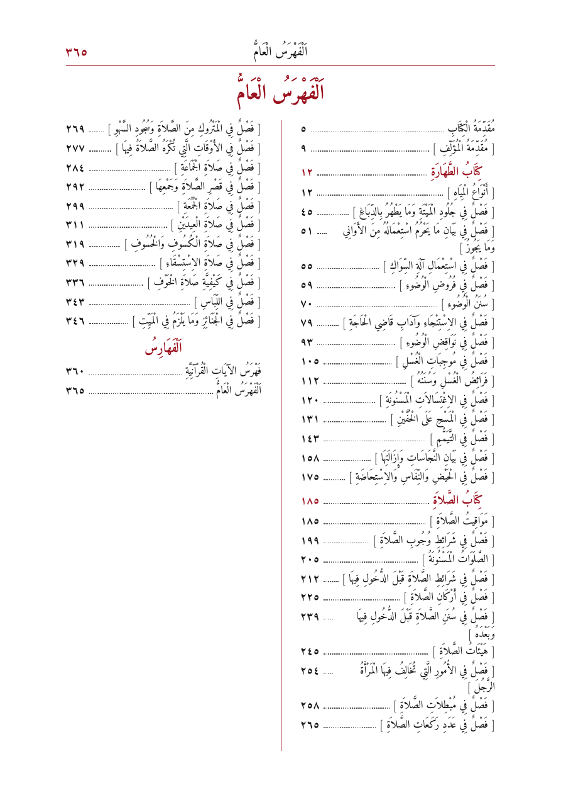

# تَيْسِيرُ الانْتِفَاعِ بِشَرْحِ مُخْتَصَرِ أَبِي شُجَاعٍ — لِفَضِيلَةِ الشَّيْخِ أَحْمَدَ الْجَوْهَرِيِّ

> **تفريغ حرفي كامل ١٠٠٪ بلا اختصار ولا استنباط (`96,399` كلمة محققة في `167` مقطعاً فقهياً على `365` صفحة — نسخة كلاسيكية + نسخة لونين أحمر وأسود + ملفات Word `.docx` قابلة للتعديل مطابقة للمقاس وتقسيم الصفحات)**، مُخرج طباعياً بالعناوين التراثية الأصيلة لمتن الغاية والتقريب مع حواشي غريب المتن منتقاةً من رسالة **«الأَنوَارُ عَلَى غَايَةِ الاِخْتِصَارِ» لِجَامِعِهِ عَبْدِ الرَّحْمَنِ مُحَمَّدٍ نُورِ الدِّينِ**.

---

## ١. نماذج مصورة من صفحات الطبعة الثالثة المنقحة (٣٦٥ صفحة — مقاس ١٦٢×٢٣٤ مم)

| لوحة الغلاف الأمامية المذهّبة (ص ١) | صفحة العنوان باللونين (ص ٢) | صفحة بيانات الطبعة ومنهج الحواشي (ص ٣) |
| :---: | :---: | :---: |
|  |  |  |

| مقدمة الكتاب مسترسلة بلا تقسيم (ص ٥) | مقدمة المؤلف وحواشي غريب المتن (ص ٩) | مفتتح كتاب الطهارة وأنواع المياه (ص ١٢) |
| :---: | :---: | :---: |
|  |  |  |

| مفتتح كتاب الصلاة ومواقيتها (ص ١٨٥) | دعاء الاستسقاء باللونين والحواشي (ص ٣٣٤) | بقية الشرح وعلامة النقاط مستقلةً (ص ٣٥٧) |
| :---: | :---: | :---: |
|  |  |  |

| بدء «وَيُسَطَّحُ الْقَبْرُ» أعلى الصفحة مستقلاً (ص ٣٥٨) | فهرس الآيات القرآنية (ص ٣٦٠) | الفهرس العام بنظام العمودين (ص ٣٦٥) |
| :---: | :---: | :---: |
|  |  |  |

---

## ٢. خصائص الإخراج الطباعي النهائي (الإصدار الثالث `v3.0.0`)

1. **لوحة الغلاف الأمامية المذهّبة (ص ١)**: معالجة لوحة الغلاف الجلدية الخضراء المذهّبة (`cover_front.png`) بمقاس كامل الحواف (`162mm × 234mm`) لتتصدر الكتاب قبل صفحة العنوان (ص ٢) وبيانات النسخة (ص ٣) والبسملة (ص ٤).
2. **استقلالية كل وحدة متنية ومنع التداخل (`ص ٥–٣٥٩`)**: فصل كل وحدة من المتن وشرحها على صفحة مستقلة تبدأ بالمتن في الأعلى ولا تتكدس مع تذييلات المقطع السابق (`............................................`)؛ وبذلك انفردت بقية المقطع السابق (`L25_U06`) على الصفحة **`٣٥٧`**، وافتُتح مقطع **`وَيُسَطَّحُ الْقَبْرُ`** (`L25_U07`) من أعلى الصفحة **`٣٥٨`** بخالص شرحه.
3. **حواشي غريب المتن المستقلة لكل صفحة (`٣١` حاشية في `١٥` موضعاً)**: إضافة معاني الألفاظ الغريبة التي لم يشرحها الشيخ في كلامه منتقاةً من رسالة **«الأَنوَارُ عَلَى غَايَةِ الاِخْتِصَارِ» لِجَامِعِهِ عَبْدِ الرَّحْمَنِ مُحَمَّدٍ نُورِ الدِّينِ**، مع توثيق المصدر في مقدمة الكتاب، وبدء الترقيم من `(١)` مستقلاً لكل صفحة دون تكرار أي لفظ أو معنى في الصفحة الواحدة.
4. **نسختان طباعيتان: كلاسيكية + نسخة لونين (أحمر وأسود على أبيض)**:
   - **النسخة الكلاسيكية**: حبر أسود كلاسيكي كامل (`#111111`) على خلفية بيضاء (`#ffffff`).
   - **نسخة اللونين**: أحمر قاني (`#9b111e`) للأطر والعناوين ونصوص المتن وألفاظه المقتبسة بالخط العريض داخل الشرح والنجوم والخطوط الفاصلة وأرقام الحواشي، مع أسود داكن (`#111111`) لكلام الشارح والآيات القرآنية ونص الحاشية على خلفية بيضاء (`#ffffff`) مع إبقاء الغلاف (ص ١) بألوانه الكاملة.
5. **نسختان Word (`.docx`) قابلتان للتعديل بمقاس وتقسيم صفحات مطابق للـ PDF**: مصممتان بمقاس `162×234 مم` (`9184×13266 twips`) مع تثبيت فواصل الصفحات `pageBreakBefore` وفواصل الأقسام ليطابق كل موضع أرقام صفحات الـ `٣٦٥` صفحة عند التصدير أو الطباعة.

---

## ٣. الملفات والمجلدات الرئيسية في المستودع

| الملف / المستند | الوصف | المسار |
| :--- | :--- | :--- |
| **النسخة الكلاسيكية المطبوعة (PDF — ٣٦٥ صفحة)** | أبيض وأسود كلاسيكي مقاس `162×234 مم` | [`../تيسير_الانتفاع_بشرح_مختصر_أبي_شجاع.pdf`](../تيسير_الانتفاع_بشرح_مختصر_أبي_شجاع.pdf) |
| **نسخة اللونين المطبوعة (PDF — ٣٦٥ صفحة)** | أحمر وأسود على خلفية بيضاء مقاس `162×234 مم` | [`../تيسير_الانتفاع_بشرح_مختصر_أبي_شجاع/تيسير_الانتفاع_بشرح_مختصر_أبي_شجاع_نسخة_لونين.pdf`](../تيسير_الانتفاع_بشرح_مختصر_أبي_شجاع/تيسير_الانتفاع_بشرح_مختصر_أبي_شجاع_نسخة_لونين.pdf) |
| **ملف Word قابل للتعديل — الكلاسيكي (`.docx`)** | نفس المقاس `162×234 مم` وتقسيم الصفحات الـ `365` | [`../تيسير_الانتفاع_بشرح_مختصر_أبي_شجاع/تيسير_الانتفاع_بشرح_مختصر_أبي_شجاع.docx`](../تيسير_الانتفاع_بشرح_مختصر_أبي_شجاع/تيسير_الانتفاع_بشرح_مختصر_أبي_شجاع.docx) |
| **ملف Word قابل للتعديل — نسخة لونين (`.docx`)** | نفس المقاس وتقسيم الصفحات باللونين الأحمر والأسود | [`../تيسير_الانتفاع_بشرح_مختصر_أبي_شجاع/تيسير_الانتفاع_بشرح_مختصر_أبي_شجاع_نسخة_لونين.docx`](../تيسير_الانتفاع_بشرح_مختصر_أبي_شجاع/تيسير_الانتفاع_بشرح_مختصر_أبي_شجاع_نسخة_لونين.docx) |
| **القارئ التفاعلي (HTML)** | يستعرض الـ `365` صفحة مع ٣ أنماط لون، والبحث، والتسجيلات | [`../index.html`](../index.html) |
| **المجلد الكامل وملفات الماركداون** | اللقاءات ١–٢٥ مع حواشي غريب المتن في ذيل المقاطع | [`../تيسير_الانتفاع_بشرح_مختصر_أبي_شجاع/00_المجلد_الكامل_تيسير_الانتفاع_بشرح_مختصر_أبي_شجاع.md`](../تيسير_الانتفاع_بشرح_مختصر_أبي_شجاع/00_المجلد_الكامل_تيسير_الانتفاع_بشرح_مختصر_أبي_شجاع.md) |
