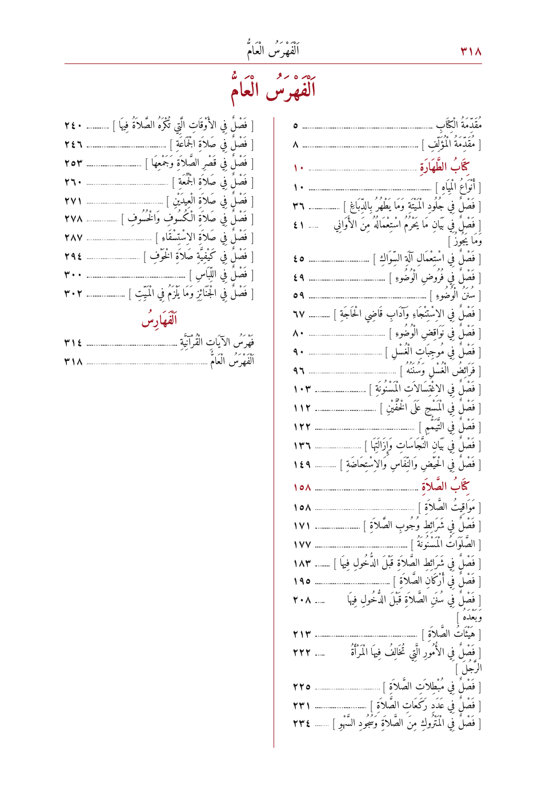
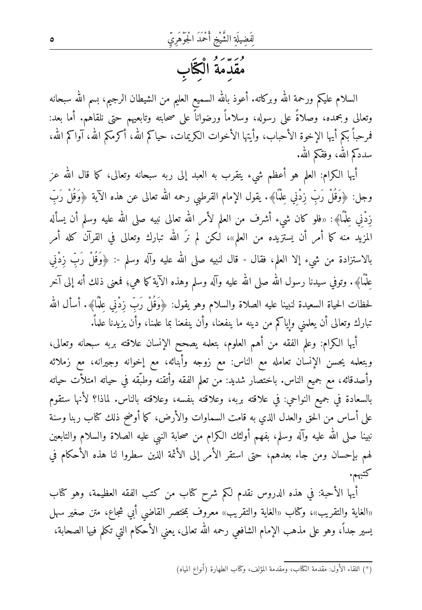
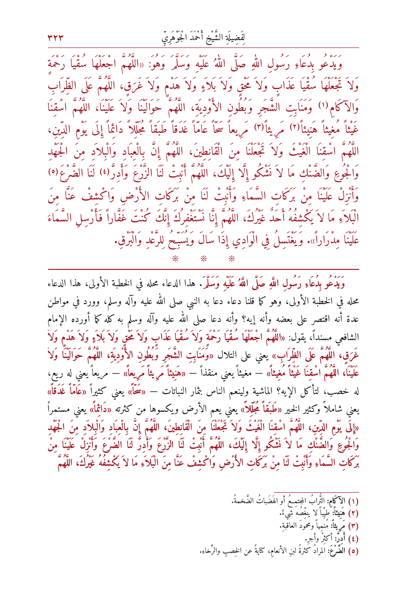
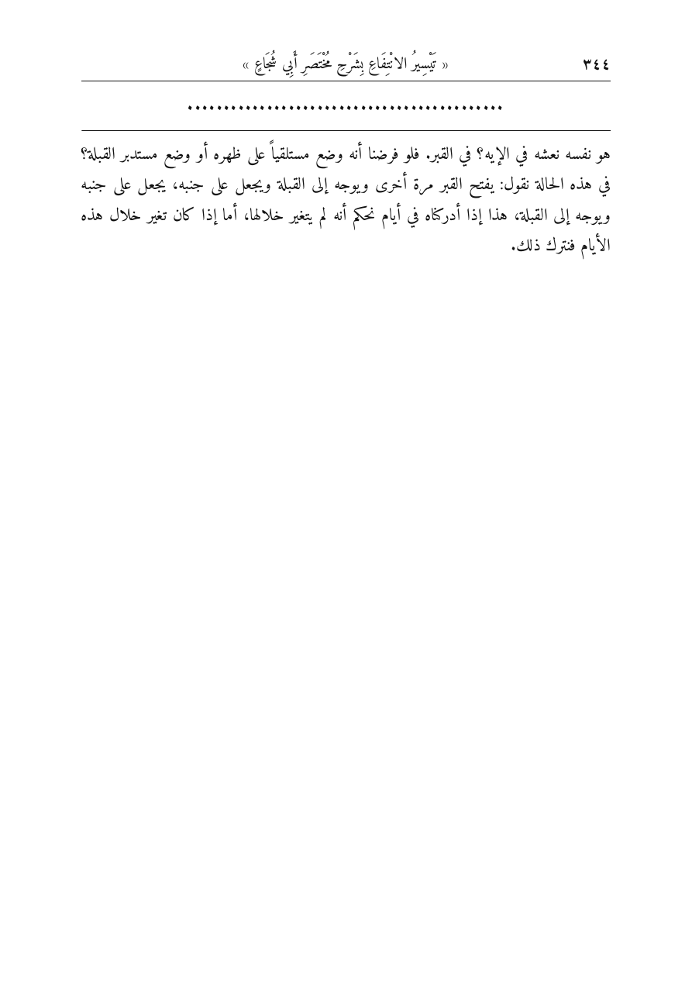
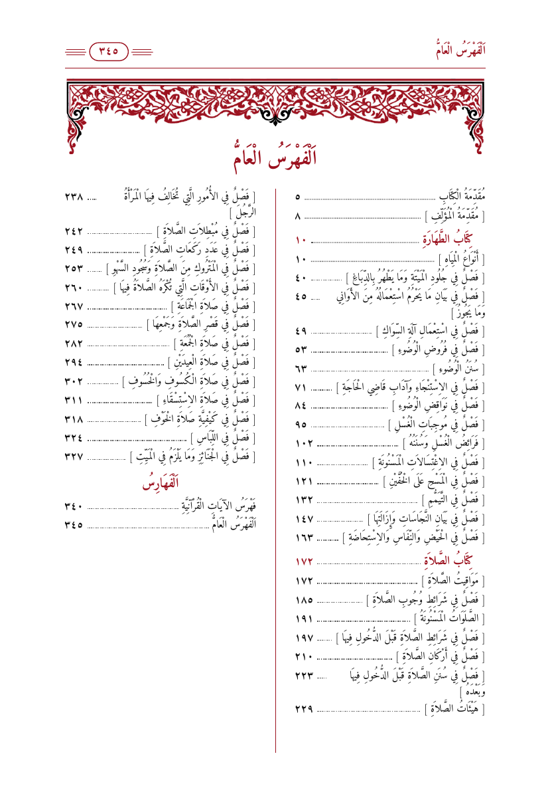

# تَيْسِيرُ الانْتِفَاعِ بِشَرْحِ مُخْتَصَرِ أَبِي شُجَاعٍ — لِفَضِيلَةِ الشَّيْخِ أَحْمَدَ الْجَوْهَرِيِّ

> **طبعتان متكاملتان:**
> 1. **النُّسْخَةُ الْمُحَرَّرَةُ بِالْعَرَبِيَّةِ الْفُصْحَى عَلَى نَسَقِ الْكُتُبِ الْفِقْهِيَّةِ (`v3.2.0` — `318` صفحة — `80,295` كلمة في `165` مقطعاً)**: خالية من العامية ومقدمات الدروس وخواتيمها وأسئلة الحضور، مع حفظ تام للمعاني والأحكام والآيات.
> 2. **النُّسْخَةُ الْحَرْفِيَّةُ الْكَامِلَةُ (`v3.1.0` — `351` صفحة — `96,399` كلمة في `167` مقطعاً)**: تفريغ حرفي كامل ١٠٠٪ بلا اختصار ولا استنباط.
>
> كلاهما مُخرج طباعياً بمقاس `162×234 مم` بالعناوين التراثية الأصيلة لمتن الغاية والتقريب مع حواشي غريب المتن منتقاةً من رسالة **«الأَنوَارُ عَلَى غَايَةِ الاِخْتِصَارِ» لِجَامِعِهِ عَبْدِ الرَّحْمَنِ مُحَمَّدٍ نُورِ الدِّينِ**، في **نسخة كلاسيكية + نسخة لونين أحمر وأسود + ملفات Word `.docx` قابلة للتعديل**.

---

## ١. نماذج مصورة من صفحات النسخة المحررة (`v3.2.0` — ٣١٨ صفحة)

| صفحة العنوان — المحررة (ص ٢) | صفحة البيانات ومنهج التحرير (ص ٣) | مقدمة الكتاب بالفصحى (ص ٥) |
| :---: | :---: | :---: |
|  |  |  |

| بدء «وَيُسَطَّحُ الْقَبْرُ» مستقلاً (ص ٣١٢) | خاتمة الكتاب الدعايئة (ص ٣١٣) | الفهرس العام بنظام العمودين (ص ٣١٨) |
| :---: | :---: | :---: |
|  |  |  |

---

## ٢. نماذج مصورة من صفحات النسخة الحرفية (`v3.1.0` — ٣٥١ صفحة)

| لوحة الغلاف الأمامية المذهّبة (ص ١) | مقدمة الكتاب الحرفية بـ «السلام عليكم» (ص ٥) | مقدمة المؤلف وحواشي غريب المتن (ص ٨) |
| :---: | :---: | :---: |
|  |  |  |

| دعاء الاستسقاء باللونين والحواشي (ص ٣٢٣) | تتمة الموضع السابق مستقلّةً (ص ٣٤٤) | بدء «وَيُسَطَّحُ الْقَبْرُ» مستقلاً (ص ٣٤٥) |
| :---: | :---: | :---: |
|  |  |  |

---

## ٣. خصائص الإخراج الطباعي النهائي (`v3.2.0` & `v3.1.0`)

1. **النُّسْخَةُ الْمُحَرَّرَةُ على نسق الكتب الفقهية (`v3.2.0` — `318` صفحة — `80,295` كلمة)**:
   - تنقية الشرح من الألفاظ العامية المصرية وفواتح الدروس وخواتيمها (`L01..L24`) ومقاطع الأسئلة الحية (`L01_U08` و`L01_U09`) وإعادة صياغتها بالعربية الفصحى الميسرة مع حفظ كامل المعاني والأحكام والآيات القرآنية (`100%` متطابقة).
   - افتتاح مقدمة الكتاب (`ص ٥`) بـ *«بسم الله الرحمن الرحيم، الحمد لله سبحانه وتعالى وبحمده...»* وختام الكتاب بدعاء علمي رصين (`ص ٣١٣`) يليق بنسق المصنفات الفقهية.
2. **لوحة الغلاف الأمامية المذهّبة (`ص ١`)** والديباجة (`ص ٢–٤`) وحفظ النسخة الحرفية (`351` صفحة) كاملةً في مجلدها المستقل.
3. **استقلالية كل وحدة متنية ومنع التداخل**: انفراد كل مقطع من المتن مع شرحه دون تداخل، وبداية **`وَيُسَطَّحُ الْقَبْرُ`** مستقلةً من أعلى الصفحة (`ص ٣١٢` في المحررة، و`ص ٣٤٥` في الحرفية).
4. **حواشي غريب المتن المستقلة لكل صفحة (`٣١` حاشية في `١٥` موضعاً)** من **«الأَنوَارُ عَلَى غَايَةِ الاِخْتِصَارِ» لِجَامِعِهِ عَبْدِ الرَّحْمَنِ مُحَمَّدٍ نُورِ الدِّينِ** بترقيم يبدأ من `(١)` في كل صفحة دون تكرار.
5. **نسختان طباعيتان: كلاسيكية + نسخة لونين (`#9b111e` + `#111111` على `#ffffff`)** و**ملفات Word (`.docx`) قابلة للتعديل** بمقاس `162×234 مم` (`318` صفحة للمحررة، و`351` صفحة للحرفية).

---

## ٤. الملفات والمجلدات الرئيسية في المستودع

| الملف / المستند | الوصف | المسار |
| :--- | :--- | :--- |
| **النسخة المحررة الكلاسيكية (`PDF` — ٣١٨ ص)** | فصحى كتابية محررة، مقاس `162×234 مم` | [`../تيسير_الانتفاع_بشرح_مختصر_أبي_شجاع_النسخة_المحررة.pdf`](../تيسير_الانتفاع_بشرح_مختصر_أبي_شجاع_النسخة_المحررة.pdf) |
| **النسخة المحررة — لونين (`PDF` — ٣١٨ ص)** | أحمر وأسود على خلفية بيضاء، مقاس `162×234 مم` | [`../تيسير_الانتفاع_بشرح_مختصر_أبي_شجاع_النسخة_المحررة/تيسير_الانتفاع_بشرح_مختصر_أبي_شجاع_النسخة_المحررة_نسخة_لونين.pdf`](../تيسير_الانتفاع_بشرح_مختصر_أبي_شجاع_النسخة_المحررة/تيسير_الانتفاع_بشرح_مختصر_أبي_شجاع_النسخة_المحررة_نسخة_لونين.pdf) |
| **ملف Word المحررة الكلاسيكية (`.docx`)** | قابل للتعديل بمقاس `162×234 مم` (`318` ص) | [`../تيسير_الانتفاع_بشرح_مختصر_أبي_شجاع_النسخة_المحررة/تيسير_الانتفاع_بشرح_مختصر_أبي_شجاع_النسخة_المحررة.docx`](../تيسير_الانتفاع_بشرح_مختصر_أبي_شجاع_النسخة_المحررة/تيسير_الانتفاع_بشرح_مختصر_أبي_شجاع_النسخة_المحررة.docx) |
| **ملف Word المحررة لونين (`.docx`)** | قابل للتعديل باللونين الأحمر والأسود (`318` ص) | [`../تيسير_الانتفاع_بشرح_مختصر_أبي_شجاع_النسخة_المحررة/تيسير_الانتفاع_بشرح_مختصر_أبي_شجاع_النسخة_المحررة_نسخة_لونين.docx`](../تيسير_الانتفاع_بشرح_مختصر_أبي_شجاع_النسخة_المحررة/تيسير_الانتفاع_بشرح_مختصر_أبي_شجاع_النسخة_المحررة_نسخة_لونين.docx) |
| **القارئ التفاعلي للنسخة المحررة (`HTML`)** | تصفح الـ `318` صفحة مع ٣ أنماط لون والبحث | [`../viewer/matn_abi_shuja_edited.html`](../viewer/matn_abi_shuja_edited.html) |
| **المجلد الكامل (`Markdown`) — المحررة** | الـ ٢٥ فصلاً/درساً كاملةً بالفصحى وحواشي *الأنوار* | [`../تيسير_الانتفاع_بشرح_مختصر_أبي_شجاع_النسخة_المحررة/00_المجلد_الكامل_تيسير_الانتفاع_النسخة_المحررة.md`](../تيسير_الانتفاع_بشرح_مختصر_أبي_شجاع_النسخة_المحررة/00_المجلد_الكامل_تيسير_الانتفاع_النسخة_المحررة.md) |
| **النسخة الحرفية الكلاسيكية (`PDF` — ٣٥١ ص)** | أبيض وأسود كلاسيكي مقاس `162×234 مم` | [`../تيسير_الانتفاع_بشرح_مختصر_أبي_شجاع.pdf`](../تيسير_الانتفاع_بشرح_مختصر_أبي_شجاع.pdf) |
| **النسخة الحرفية — لونين (`PDF` — ٣٥١ ص)** | أحمر وأسود على خلفية بيضاء مقاس `162×234 مم` | [`../تيسير_الانتفاع_بشرح_مختصر_أبي_شجاع/تيسير_الانتفاع_بشرح_مختصر_أبي_شجاع_نسخة_لونين.pdf`](../تيسير_الانتفاع_بشرح_مختصر_أبي_شجاع/تيسير_الانتفاع_بشرح_مختصر_أبي_شجاع_نسخة_لونين.pdf) |
| **ملف Word الحرفي الكلاسيكي (`.docx`)** | نفس المقاس `162×234 مم` وتقسيم الصفحات الـ `351` | [`../تيسير_الانتفاع_بشرح_مختصر_أبي_شجاع/تيسير_الانتفاع_بشرح_مختصر_أبي_شجاع.docx`](../تيسير_الانتفاع_بشرح_مختصر_أبي_شجاع/تيسير_الانتفاع_بشرح_مختصر_أبي_شجاع.docx) |
| **ملف Word الحرفي لونين (`.docx`)** | نفس المقاس وتقسيم الصفحات باللونين الأحمر والأسود | [`../تيسير_الانتفاع_بشرح_مختصر_أبي_شجاع/تيسير_الانتفاع_بشرح_مختصر_أبي_شجاع_نسخة_لونين.docx`](../تيسير_الانتفاع_بشرح_مختصر_أبي_شجاع/تيسير_الانتفاع_بشرح_مختصر_أبي_شجاع_نسخة_لونين.docx) |
| **القارئ التفاعلي للنسخة الحرفية (`HTML`)** | يستعرض الـ `351` صفحة مع ٣ أنماط لون، والبحث، والتسجيلات | [`../index.html`](../index.html) |
