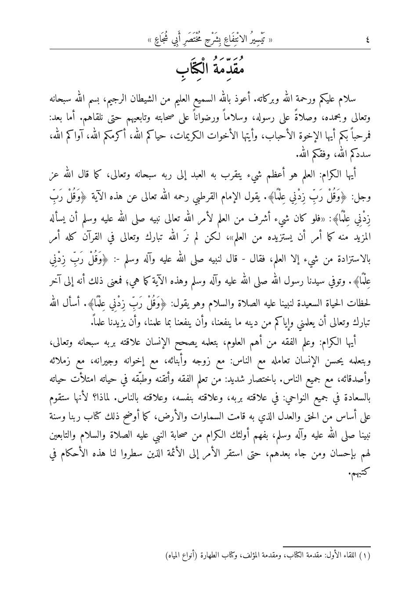
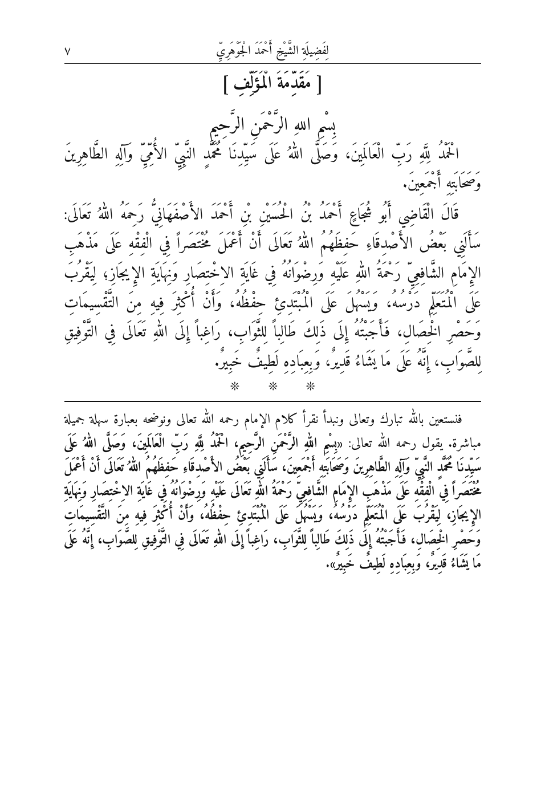
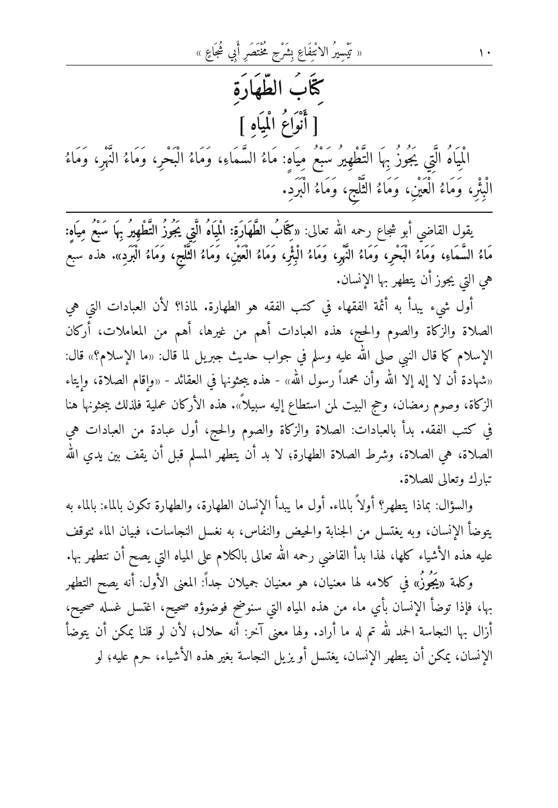
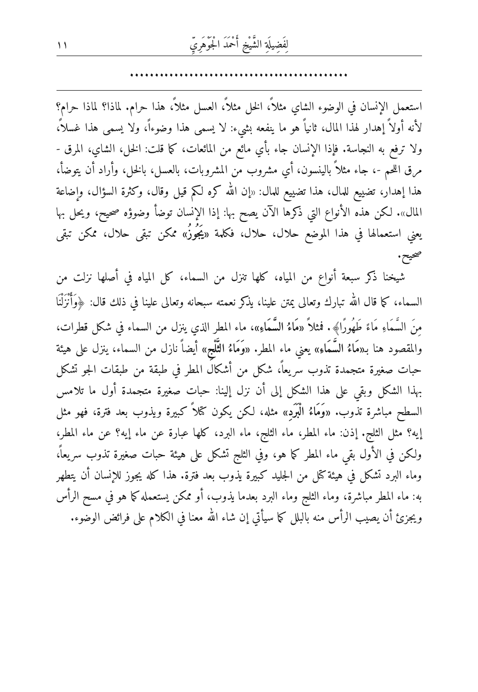
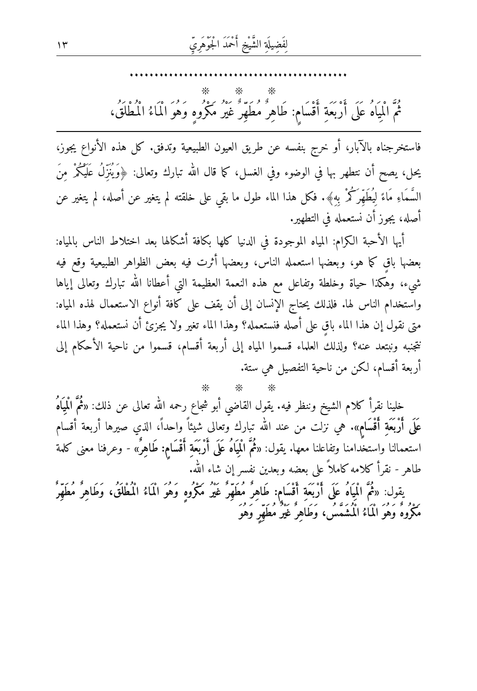
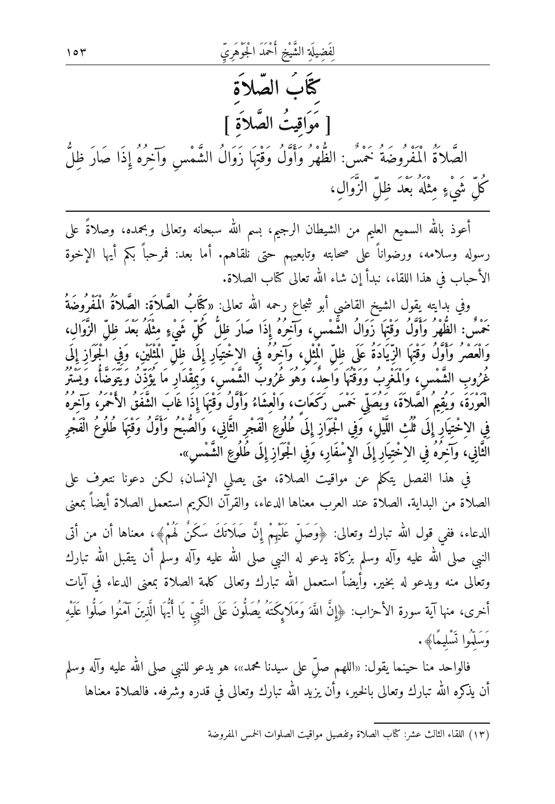
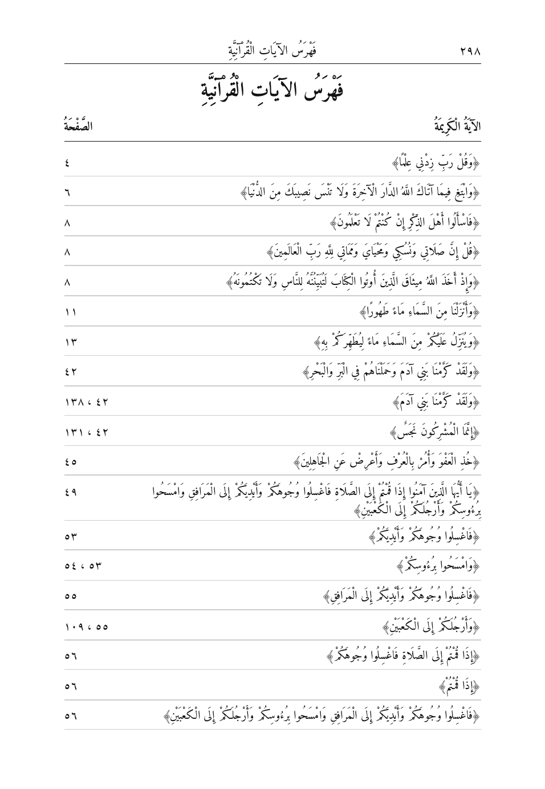
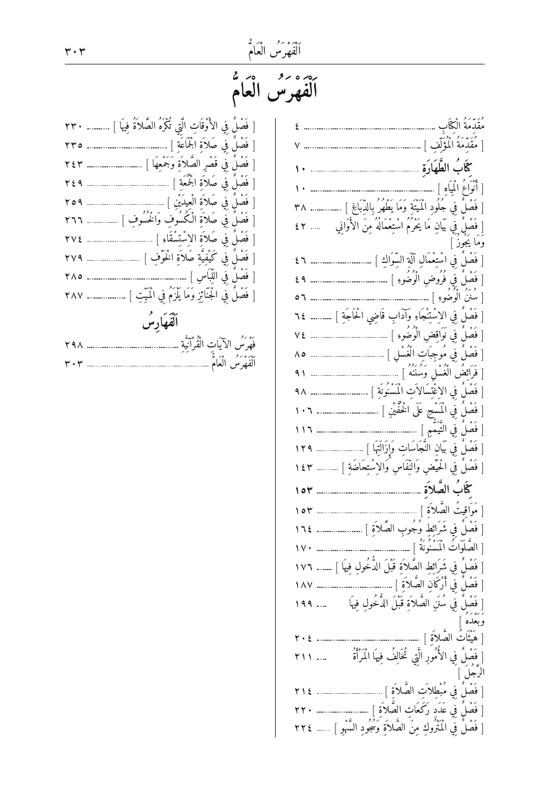

# تَيْسِيرُ الانْتِفَاعِ بِشَرْحِ مُخْتَصَرِ أَبِي شُجَاعٍ — لِفَضِيلَةِ الشَّيْخِ أَحْمَدَ الْجَوْهَرِيِّ

> **تفريغ حرفي كامل ١٠٠٪ بلا اختصار ولا استنباط (`96,399` كلمة محققة في `167` مقطعاً فقهياً على `303` صفحات)**، مُخرج طباعياً بدقة متناهية بالعناوين التراثية الأصيلة لمتن الغاية والتقريب دون إضافات خارجية.

---

## ١. نماذج مصورة من صفحات الكتاب المطبوع (٣٠٣ صفحات — مقاس ١٦٢×٢٣٤ مم)

| صفحة الغلاف (ص ١) | صفحة بيانات الطبعة (ص ٢) | مقدمة الكتاب مسترسلة (ص ٤) |
| :---: | :---: | :---: |
|  |  |  |

| مقدمة المؤلف والبسملة (ص ٧) | مفتتح كتاب الطهارة (ص ١٠) | متابعة الشرح وعلامة النقاط (ص ١١) |
| :---: | :---: | :---: |
|  |  |  |

| تتابع المقاطع (ص ١٣) | مفتتح كتاب الصلاة (ص ١٥٣) | فهرس الآيات (ص ٢٩٨) | الفهرس العام (ص ٣٠٣) |
| :---: | :---: | :---: | :---: |
|  |  |  |  |

---

## ٢. خصائص الإخراج الطباعي النهائي

1. **مقاس القطع والصفحة (`162mm × 234mm`)**: بهامش علمي كلاسيكي، وترويسة علوية متناوبة تحمل عنوان **`« تَيْسِيرُ الانْتِفَاعِ بِشَرْحِ مُخْتَصَرِ أَبِي شُجَاعٍ »`** في الصفحات الزوجية و**`لِفَضِيلَةِ الشَّيْخِ أَحْمَدَ الْجَوْهَرِيِّ`** في الصفحات الفردية مع الأرقام العربية المشرقية.
2. **استرسال «مُقَدِّمَةُ الْكِتَابِ» (ص ٤–٦)**: إثبات كافة التمهيد الذي قبل قول القاضي أبي شجاع كمقدمة مسترسلة في مستهل الكتاب دون تقسيم للمتن أو خط فاصل، ودون جدول لقاءات صوتية أو ترجمة مصطنعة في التقديم.
3. **العناوين الأصلية للمتن فقط**: إثبات عناوين المتن الحقيقية (`كِتَابُ الطَّهَارَةِ`، `كِتَابُ الصَّلاَةِ`، والفصول المعقوفة `[ ... ]`) وحذف العناوين الفرعية المستحدثة وترويسات الشرح أسفل الخط الفاصل.
4. **علامة متابعة الشرح والسطر الأخير الطبيعي**: عند امتداد شرح موضع واحد على أكثر من صفحة توضع علامة النقاط المتوسطة (`............................................`) أعلى الخط الفاصل، مع إبقاء السطر الأخير من الشطر المشقوق محاذاً لليمين بمسافات طبيعية (`text-align-last: right`).
5. **الفهارس العلمية في خاتمة الكتاب**: فهرس الآيات القرآنية (ص ٢٩٨–٣٠٢) ثم الفهرس العام بنظام العمودين المتناظرين والنقاط القائدة وأرقام الصفحات المشرقية (ص ٣٠٣).

---

## ٣. الملفات والمجلدات الرئيسية في المستودع

| الملف / المستند | الوصف | المسار |
| :--- | :--- | :--- |
| **نسخة الكتاب المطبوع الكاملة (PDF)** | ٣٠٣ صفحة جاهزة للطباعة والمذاكرة | [`../تيسير_الانتفاع_بشرح_مختصر_أبي_شجاع.pdf`](../تيسير_الانتفاع_بشرح_مختصر_أبي_شجاع.pdf) |
| **القارئ التفاعلي لصفحات الكتاب (HTML)** | يستعرض الصفحات الـ ٣٠٣ مع البحث والفهارس والتسجيلات | [`../index.html`](../index.html) |
| **ملف الكتاب المنسق للطباعة (HTML)** | النسخة المصدرية المقسمة إلى ٣٠٣ صفحات | [`../book_engine/full_book.html`](../book_engine/full_book.html) |
| **المجلد الكامل (Markdown)** | يجمع اللقاءات ١–٢٥ كاملة بتنسيق المتن والشرح | [`../تيسير_الانتفاع_بشرح_مختصر_أبي_شجاع/00_المجلد_الكامل_تيسير_الانتفاع_بشرح_مختصر_أبي_شجاع.md`](../تيسير_الانتفاع_بشرح_مختصر_أبي_شجاع/00_المجلد_الكامل_تيسير_الانتفاع_بشرح_مختصر_أبي_شجاع.md) |
| **المجلد الأول: كتاب الطهارة (Markdown)** | اللقاءات ١–١٢ كاملة | [`../تيسير_الانتفاع_بشرح_مختصر_أبي_شجاع/المجلد_الأول_مقدمة_الكتاب_وكتاب_الطهارة_اللقاءات_1_إلى_12.md`](../تيسير_الانتفاع_بشرح_مختصر_أبي_شجاع/المجلد_الأول_مقدمة_الكتاب_وكتاب_الطهارة_اللقاءات_1_إلى_12.md) |
| **المجلد الثاني: كتاب الصلاة (Markdown)** | اللقاءات ١٣–٢٥ كاملة | [`../تيسير_الانتفاع_بشرح_مختصر_أبي_شجاع/المجلد_الثاني_كتاب_الصلاة_اللقاءات_13_إلى_25.md`](../تيسير_الانتفاع_بشرح_مختصر_أبي_شجاع/المجلد_الثاني_كتاب_الصلاة_اللقاءات_13_إلى_25.md) |
